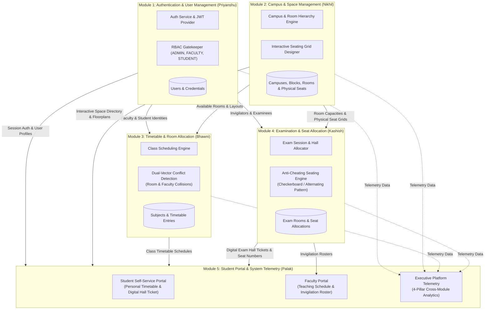
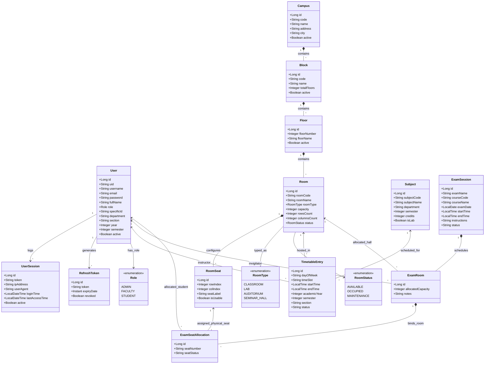

# CampusGrid: Campus Space & Seating Management System

## Week 1

## Project Administration

**Project Guide:** Er. Ram Babu Buri
* **Research Area:** Machine Learning & Data Science
* **Specializations:** Java, JSP–Servlet, Spring Boot, MySQL, Python


### Team Members

| # | Name | Enrollment | Email | Mobile |
| :--- | :--- | :--- | :--- | :--- |
| 1 | Nikhil Kumawat | 24E1ARADM30P111 | nk2423797@gmail.com | 9887251846 |
| 2 | Palak Nandani | 24E1ARADF10P116 | palaknlalawat@gmail.com | 8005501729 |
| 3 | Kashish Upadhyay | 24E1ARADF40P079 | kashishu314@gmail.com | 9887760412 |
| 4 | Priyanshu Kumar | 24E1ARADM40P126 | priyanshuv1710@gmail.com | 7014827524 |
| 5 | Bhawni Kumari | 24E1ARADF40P032 | bhawni2006@gmail.com | 9102461981 |

---

## Abstract

This project introduces CampusGrid, a comprehensive campus space and seating management platform engineered to address the operational challenges faced by educational institutions in managing their physical infrastructure. While traditional manual processes and fragmented spreadsheet-based systems lack the real-time visibility and control required for efficient campus resource utilization, CampusGrid provides a centralized, role-based environment for administrators, faculty, and students to discover, manage, and interact with campus spaces, rooms, and seating arrangements.

The system operates on a monolithic Spring Boot backend with a layered architecture. It utilizes MySQL for ACID-compliant data storage, managing the complete hierarchical structure of campus entities — from campuses and blocks down to floors, rooms, and individual physical seats. The client-side interface, developed using HTML, CSS, and JavaScript, features dedicated dashboards for each user role: administrators can configure campus hierarchies and design interactive seating layouts, faculty can view space assignments, and students can explore available resources across the campus. The platform enforces stateless, JWT-based authentication and Role-Based Access Control (RBAC) using Spring Security to ensure that each user interacts only with functionality appropriate to their role.

Ultimately, CampusGrid converges these architectural components into a unified space management solution. The platform bridges the gap between physical infrastructure and digital management, providing administrators with real-time occupancy insights, dynamic seating layout configuration, and streamlined room management. The resulting system empowers institutions to maximize their spatial resources, eliminate scheduling conflicts, and deliver a transparent and accessible campus experience to all stakeholders.

---

## Week 2

## User Roles
CampusGrid enforces strict Role-Based Access Control (RBAC) at the API and service layers utilizing Spring Security and stateless JSON Web Tokens (JWT).
* **Administrator (`ADMIN`)**: Full platform authority to manage campus hierarchies, design visual seating layouts, coordinate master timetable schedules, configure examination sessions, trigger automated anti-cheating seat allocations, and oversee user lifecycle management.
* **Faculty Member (`FACULTY`)**: Permitted to view individual weekly teaching timetables, check classroom availability, access subject course details, and inspect assigned examination invigilation duty rosters with real-time room and headcount data.
* **Student (`STUDENT`)**: Granted access to a personalized student self-service portal to review weekly class schedules, enrolled subject directories, upcoming examination dates, and digital hall tickets with assigned room numbers and designated physical seats.

---

### SRS PDF

You can access the [Project SRS Click](https://drive.google.com/file/d/1LixhIziyjHDVCXckHiU0Rzo9B0P1E16u/view?usp=drive_link)

---

## Architecture & Core Modules

The CampusGrid platform operates on a modular, monolithic Spring Boot architecture with a layered service-oriented design. The backend acts as the central orchestrator providing RESTful API endpoints consumed by responsive HTML5/CSS3/JavaScript client dashboards.

### Functional Modules

* **Module 1: Authentication + User Management** *(Lead: Priyanshu Kumar)*
  Validates credentials and issues secure, time-bound stateless JSON Web Tokens (JWT) with refresh token rotation. It enforces Role-Based Access Control (RBAC) across three distinct roles (`ADMIN`, `FACULTY`, `STUDENT`), handles BCrypt password hashing, manages user profile metadata, department allocations, session logging, and tracks client IP addresses and user agents for security audits.

* **Module 2: Campus and Room Management** *(Lead: Nikhil Kumawat)*
  Manages the spatial infrastructure across a 4-tier hierarchy: Campuses ➔ Academic Blocks ➔ Floors ➔ Rooms. Features an interactive Visual Seating Designer enabling administrators to customize room layouts (grid dimensions, aisle spacing, seat numbering, and usability status). It maintains live room occupancy statuses (`AVAILABLE`, `OCCUPIED`, `MAINTENANCE`) and categorizes facilities into lecture halls, labs, auditoriums, and seminar rooms.

* **Module 3: Timetable + Room Allocation** *(Lead: Bhawni Kumari)*
  Provides an automated scheduling engine for academic courses and recurring weekly time slots. Features a robust dual-vector conflict detection system:
  * **Room Conflict Detection**: Prevents spatial double-booking by ensuring no room hosts overlapping lectures.
  * **Faculty Conflict Detection**: Ensures instructors cannot be scheduled for concurrent teaching commitments across multiple locations.
  It also manages subject catalogs, course credits, and department-semester-section groupings.

* **Module 4: Examination + Seat Allocation** *(Lead: Kashish Upadhyay)*
  Coordinates examination sessions, date-time intervals, room capacity constraints, and faculty invigilator assignments. Features an intelligent anti-cheating seating engine that:
  * Dynamically allocates students across available examination halls according to configured room grid capacities.
  * Implements an alternating/checkerboard seating distribution pattern that separates students of the same department or subject, preventing adjacent placement and upholding academic integrity.

* **Module 5: Student Portal + UI Integration** *(Lead: Palak Nandani)*
  Integrates all backend engines into unified, accessible client portals and analytical interfaces:
  * **Student Portal**: Displays personal academic profiles, real-time class timetables, and digital examination hall tickets featuring assigned room codes, floor numbers, and specific seat labels (e.g., `A-01`).
  * **Faculty Portal**: Displays teaching timetables alongside invigilation duty assignments with live room rosters.
  * **Executive Analytics & System Tools**: Surfaces cross-module platform telemetry, tracking total space utilization, room capacity metrics, active schedule slots, and examination readiness across all four engines.

---

## Database Strategy & Persistence Architecture

CampusGrid employs an ACID-compliant Relational Database Architecture (MySQL for production, in-memory H2 for rapid development and testing) orchestrated through Spring Data JPA and Hibernate ORM.

### Relational Schema Design & Entity Mapping
* **Identity & Security Layer (`users`, `user_sessions`, `refresh_tokens`)**: Stores user accounts, encrypted credentials, role enumerations, profile metadata (department, semester, roll number, employee ID), and audit logs.
* **Spatial Hierarchy Layer (`campuses`, `blocks`, `floors`, `rooms`, `room_seats`)**: Maintains strict referential integrity with cascading updates and deletes. The `room_seats` table stores individual coordinate-based seat records (`row_index`, `col_index`, `seat_label`, `is_usable`) for fine-grained seating matrix management.
* **Academic Scheduling Layer (`subjects`, `timetable_entries`)**: Enforces foreign keys linking subjects, faculty members, and target rooms. Unique composite indexes prevent concurrent room or faculty bookings within identical time windows.
* **Examination Management Layer (`exam_sessions`, `exam_rooms`, `exam_seat_allocations`)**: Tracks exam metadata, allotted room capacities, assigned faculty invigilators, and individual student seat allocations (`seat_id`, `seat_number`, `student_id`).

### Data Integrity & Transaction Management
* **Declarative Transactions**: Critical operations like automated exam seating allocation and timetable generation run under `@Transactional(isolation = Isolation.READ_COMMITTED)` to prevent race conditions during concurrent bookings.
* **Entity Validation**: Model constraints are strictly enforced via Jakarta Validation (`@NotBlank`, `@NotNull`, `@Size`, `@Pattern`) before persisting to the database.

---

## Non-Functional Requirements

* **Performance & Low Latency**: 
  * Room availability lookups and timetable queries execute in under 100ms.
  * The anti-cheating seat allocation engine completes seating for a 500-student examination batch in under 300ms.
* **Security & Authentication**:
  * Passwords encrypted using BCrypt with salt rounds.
  * Stateless JWT authentication with short-lived access tokens (15 minutes) and revocable refresh tokens.
  * Role-based authorization interceptors protecting all administrative and management endpoints.
* **Conflict Prevention & Fault Tolerance**:
  * Dual-vector collision detection engine prevents overlapping timetable bookings and double-allocated exam seats.
  * Comprehensive error handling providing structured `ApiResponse<T>` payloads with meaningful error messages and timestamps.
* **Scalability & Maintainability**:
  * Clean separation of concerns across Controller, Service, DTO, Repository, and Entity layers.
  * Modular design enabling each of the 5 functional engines to be maintained, tested, or scaled independently.

---

## Week 3: System Architecture & UML Design

### 1. Inter-Module Integration & Data Flow Architecture

The following architectural diagram illustrates how all five functional modules integrate with each other, sharing live data contracts across authentication, spatial hierarchy, scheduling, anti-cheating exam seating, and student self-service.



---

### 2. Comprehensive UML Class Diagram

This class diagram models all domain entities, relationships, attributes, and enumerations across the five integrated modules:



---

### 3. Entity-Relationship (ER) Diagram

The ER diagram defines the relational persistence model, foreign key linkages, and table schemas managed by Spring Data JPA:


---

## Week 4: Database Design & UI Mock-ups

### 1. Database Architecture & Relational Schema Specifications

CampusGrid operates on an enterprise relational schema design enforcing strict ACID compliance, referential integrity with cascading constraints, and index optimizations across all five interconnected modules.

#### A. Authentication & User Identity Layer (Module 1)

* **`users` Table**: Core identity, credentials, roles, and demographic profiles.
  * `id` (`BIGINT`, `PRIMARY KEY`, `AUTO_INCREMENT`)
  * `uid` (`VARCHAR(36)`, `UNIQUE`, `NOT NULL`) — Canonical public UUID (`USR-XXXXXXXX`)
  * `username` (`VARCHAR(50)`, `UNIQUE`, `NOT NULL`) — Unique sign-in handle
  * `email` (`VARCHAR(100)`, `UNIQUE`, `NOT NULL`) — Institutional email address
  * `password` (`VARCHAR(255)`, `NOT NULL`) — BCrypt hashed password (10 salt rounds)
  * `full_name` (`VARCHAR(100)`, `NOT NULL`) — Legal full name
  * `role` (`VARCHAR(20)`, `NOT NULL`) — `ADMIN`, `FACULTY`, `STUDENT`
  * `specific_id` (`VARCHAR(50)`) — Student Roll Number (`23CSE001`) or Faculty ID (`FAC001`)
  * `department` (`VARCHAR(100)`) — Academic department (e.g., *Computer Science*)
  * `section` (`VARCHAR(20)`) — Assigned student cohort (e.g., *CSE-A*)
  * `designation` (`VARCHAR(100)`) — Faculty designation (e.g., *Associate Professor*)
  * `year` (`INT`, `DEFAULT 0`) — Current academic year (1 to 4)
  * `semester` (`INT`, `DEFAULT 0`) — Current academic semester (1 to 8)
  * `active` (`BOOLEAN`, `DEFAULT TRUE`) — Account operational status
  * `created_at` (`TIMESTAMP`, `DEFAULT CURRENT_TIMESTAMP`)

* **`user_sessions` Table**: Tracks active logins, IP addresses, and user-agent metadata.
  * `id` (`BIGINT`, `PRIMARY KEY`, `AUTO_INCREMENT`)
  * `user_id` (`BIGINT`, `FOREIGN KEY` -> `users.id`, `ON DELETE CASCADE`)
  * `token` (`VARCHAR(512)`, `NOT NULL`) — Active access token hash
  * `ip_address` (`VARCHAR(45)`) — Client IPv4 / IPv6 address
  * `user_agent` (`VARCHAR(255)`) — Client browser and operating system details
  * `login_time` (`TIMESTAMP`, `NOT NULL`) — Authentication timestamp
  * `last_access_time` (`TIMESTAMP`) — Most recent API interaction
  * `active` (`BOOLEAN`, `DEFAULT TRUE`) — Live session status

* **`refresh_tokens` Table**: Secure long-lived refresh token rotation.
  * `id` (`BIGINT`, `PRIMARY KEY`, `AUTO_INCREMENT`)
  * `user_id` (`BIGINT`, `FOREIGN KEY` -> `users.id`, `ON DELETE CASCADE`)
  * `token` (`VARCHAR(255)`, `UNIQUE`, `NOT NULL`) — Cryptographic UUID refresh token
  * `expiry_date` (`TIMESTAMP`, `NOT NULL`) — 7-day token expiration boundary
  * `revoked` (`BOOLEAN`, `DEFAULT FALSE`) — Invalidation state flag

---

#### B. Campus Spatial Hierarchy & Seating Matrix (Module 2)

* **`campuses` Table**: Top-level physical campus facilities.
  * `id` (`BIGINT`, `PRIMARY KEY`, `AUTO_INCREMENT`)
  * `code` (`VARCHAR(20)`, `UNIQUE`, `NOT NULL`) — Institutional campus identifier (`MAIN-01`)
  * `name` (`VARCHAR(100)`, `NOT NULL`) — Official campus name
  * `address` (`VARCHAR(255)`) — Geographic street location
  * `city` (`VARCHAR(50)`) — City location
  * `active` (`BOOLEAN`, `DEFAULT TRUE`)

* **`blocks` Table**: Buildings and academic wings within a campus.
  * `id` (`BIGINT`, `PRIMARY KEY`, `AUTO_INCREMENT`)
  * `campus_id` (`BIGINT`, `FOREIGN KEY` -> `campuses.id`, `ON DELETE CASCADE`)
  * `code` (`VARCHAR(20)`, `NOT NULL`) — Block code (`BLK-A`)
  * `name` (`VARCHAR(100)`, `NOT NULL`) — Academic Block name (e.g., *Academic Block A*)
  * `total_floors` (`INT`, `NOT NULL`, `DEFAULT 1`) — Vertical floor count
  * `active` (`BOOLEAN`, `DEFAULT TRUE`)

* **`floors` Table**: Vertical floor levels within an academic block.
  * `id` (`BIGINT`, `PRIMARY KEY`, `AUTO_INCREMENT`)
  * `block_id` (`BIGINT`, `FOREIGN KEY` -> `blocks.id`, `ON DELETE CASCADE`)
  * `floor_number` (`INT`, `NOT NULL`) — Level integer (0 = Ground Floor, 1 = 1st Floor)
  * `floor_name` (`VARCHAR(50)`) — Display name (e.g., *First Floor*)
  * `active` (`BOOLEAN`, `DEFAULT TRUE`)

* **`rooms` Table**: Classrooms, laboratories, auditoriums, and halls.
  * `id` (`BIGINT`, `PRIMARY KEY`, `AUTO_INCREMENT`)
  * `floor_id` (`BIGINT`, `FOREIGN KEY` -> `floors.id`, `ON DELETE CASCADE`)
  * `room_code` (`VARCHAR(30)`, `UNIQUE`, `NOT NULL`) — Room numbering identifier (`A-101`)
  * `room_name` (`VARCHAR(100)`, `NOT NULL`) — Room display name (e.g., *Lecture Hall 101*)
  * `room_type` (`VARCHAR(30)`, `NOT NULL`) — `CLASSROOM`, `LAB`, `AUDITORIUM`, `SEMINAR_HALL`
  * `capacity` (`INT`, `NOT NULL`) — Maximum seating capacity
  * `rows_count` (`INT`, `NOT NULL`, `DEFAULT 6`) — Grid rows count
  * `columns_count` (`INT`, `NOT NULL`, `DEFAULT 6`) — Grid columns count
  * `status` (`VARCHAR(20)`, `NOT NULL`, `DEFAULT 'AVAILABLE'`) — `AVAILABLE`, `OCCUPIED`, `MAINTENANCE`

* **`room_seats` Table**: Fine-grained coordinate-level seating slots for examinations and classes.
  * `id` (`BIGINT`, `PRIMARY KEY`, `AUTO_INCREMENT`)
  * `room_id` (`BIGINT`, `FOREIGN KEY` -> `rooms.id`, `ON DELETE CASCADE`)
  * `row_index` (`INT`, `NOT NULL`) — Zero-indexed vertical row coordinate
  * `col_index` (`INT`, `NOT NULL`) — Zero-indexed horizontal column coordinate
  * `seat_label` (`VARCHAR(20)`, `NOT NULL`) — Alphanumeric physical label (`A-01`, `B-04`)
  * `is_usable` (`BOOLEAN`, `DEFAULT TRUE`) — Functional / broken / aisle state
  * `status` (`VARCHAR(20)`, `DEFAULT 'AVAILABLE'`) — Current availability state

---

#### C. Academic Timetable & Scheduling Engine (Module 3)

* **`subjects` Table**: Academic curriculum course repository.
  * `id` (`BIGINT`, `PRIMARY KEY`, `AUTO_INCREMENT`)
  * `subject_code` (`VARCHAR(20)`, `UNIQUE`, `NOT NULL`) — Course catalogue code (`CS301`)
  * `subject_name` (`VARCHAR(100)`, `NOT NULL`) — Course title (e.g., *Data Structures & Algorithms*)
  * `department` (`VARCHAR(100)`, `NOT NULL`) — Offering academic department
  * `semester` (`INT`, `NOT NULL`) — Targeted semester curriculum
  * `credits` (`INT`, `NOT NULL`, `DEFAULT 3`) — Academic credit points
  * `is_lab` (`BOOLEAN`, `DEFAULT FALSE`) — Practical laboratory classification flag

* **`timetable_entries` Table**: Master weekly timetable schedule slots with conflict indexing.
  * `id` (`BIGINT`, `PRIMARY KEY`, `AUTO_INCREMENT`)
  * `subject_id` (`BIGINT`, `FOREIGN KEY` -> `subjects.id`, `ON DELETE RESTRICT`)
  * `faculty_id` (`BIGINT`, `FOREIGN KEY` -> `users.id`, `ON DELETE RESTRICT`)
  * `room_id` (`BIGINT`, `FOREIGN KEY` -> `rooms.id`, `ON DELETE RESTRICT`)
  * `day_of_week` (`VARCHAR(20)`, `NOT NULL`) — `MONDAY`, `TUESDAY`, `WEDNESDAY`, `THURSDAY`, `FRIDAY`, `SATURDAY`
  * `time_slot` (`VARCHAR(50)`, `NOT NULL`) — Display slot label (`09:00 - 10:00`)
  * `start_time` (`TIME`, `NOT NULL`) — Exact start time boundary
  * `end_time` (`TIME`, `NOT NULL`) — Exact end time boundary
  * `academic_year` (`INT`, `NOT NULL`) — Targeted cohort year
  * `semester` (`INT`, `NOT NULL`) — Targeted cohort semester
  * `section` (`VARCHAR(20)`, `NOT NULL`) — Cohort section identifier (`CSE-A`)
  * `status` (`VARCHAR(20)`, `DEFAULT 'SCHEDULED'`) — `SCHEDULED`, `CANCELLED`, `RESCHEDULED`

---

#### D. Examination Management & Anti-Cheating Seating Engine (Module 4)

* **`exam_sessions` Table**: Term examination sittings and temporal slots.
  * `id` (`BIGINT`, `PRIMARY KEY`, `AUTO_INCREMENT`)
  * `exam_name` (`VARCHAR(150)`, `NOT NULL`) — Examination title (e.g., *Mid-Term Exam: Operating Systems*)
  * `course_code` (`VARCHAR(30)`, `NOT NULL`) — Examined course code (`CS304`)
  * `course_name` (`VARCHAR(150)`, `NOT NULL`) — Full course name
  * `exam_date` (`DATE`, `NOT NULL`) — Scheduled calendar examination date
  * `start_time` (`TIME`, `NOT NULL`) — Examination paper commencement time
  * `end_time` (`TIME`, `NOT NULL`) — Examination paper conclusion time
  * `instructions` (`TEXT`) — Rules, calculators, admit card notices
  * `status` (`VARCHAR(30)`, `DEFAULT 'SCHEDULED'`) — `SCHEDULED`, `ALLOCATION_COMPLETE`, `CONCLUDED`

* **`exam_rooms` Table**: Examination hall assignments, capacity quotas, and assigned invigilators.
  * `id` (`BIGINT`, `PRIMARY KEY`, `AUTO_INCREMENT`)
  * `exam_session_id` (`BIGINT`, `FOREIGN KEY` -> `exam_sessions.id`, `ON DELETE CASCADE`)
  * `room_id` (`BIGINT`, `FOREIGN KEY` -> `rooms.id`, `ON DELETE RESTRICT`)
  * `invigilator_id` (`BIGINT`, `FOREIGN KEY` -> `users.id`, `ON DELETE SET NULL`) — Faculty invigilator
  * `allocated_capacity` (`INT`, `NOT NULL`) — Cap on usable examinee seats
  * `notes` (`VARCHAR(255)`) — Hall specific notes

* **`exam_seat_allocations` Table**: Individual student seat allocations generated by the anti-cheating algorithm.
  * `id` (`BIGINT`, `PRIMARY KEY`, `AUTO_INCREMENT`)
  * `exam_room_id` (`BIGINT`, `FOREIGN KEY` -> `exam_rooms.id`, `ON DELETE CASCADE`)
  * `student_id` (`BIGINT`, `FOREIGN KEY` -> `users.id`, `ON DELETE CASCADE`) — Examinee student
  * `seat_id` (`BIGINT`, `FOREIGN KEY` -> `room_seats.id`, `ON DELETE RESTRICT`) — Designated physical seat
  * `seat_number` (`VARCHAR(20)`, `NOT NULL`) — Physical seat coordinate label (`A-01`, `B-02`)
  * `seat_status` (`VARCHAR(20)`, `DEFAULT 'CONFIRMED'`) — `CONFIRMED`, `ABSENT`, `REALLOCATED`

---

### 2. User Interface (UI) Mock-ups

CampusGrid features a modern, clean, and responsive design system implemented in HTML5, CSS3, and JavaScript, styled with institutional indigo accents and accessible typography.

#### A. Interactive Visual Seating Grid Designer (Module 2)
Allows campus administrators to configure room dimensions, set up aisles, toggle broken/unavailable seats, and preview the physical arrangement before scheduling.

```text
+---------------------------------------------------------------------------------------------------+
|  CampusGrid Admin > Space Directory > Seating Layout Designer                                     |
+---------------------------------------------------------------------------------------------------+
|  [Room: Lecture Hall 101 (A-101)]   [Rows: 6] [Cols: 6] [Total: 36 Seats]    [Save Layout Button]  |
|                                                                                                   |
|                                 +-----------------------+                                         |
|                                 |    PODIUM / STAGE     |                                         |
|                                 +-----------------------+                                         |
|                                                                                                   |
|    Row A:   [ A-01 (Usable) ]  [ A-02 (Usable) ]   | AISLE |   [ A-03 (Usable) ]  [ A-04 (Usable) ]   |
|    Row B:   [ B-01 (Usable) ]  [ B-02 (Usable) ]   | AISLE |   [ B-03 (Usable) ]  [ B-04 (Usable) ]   |
|    Row C:   [ C-01 (Usable) ]  [ C-02 (Disabled)]  | AISLE |   [ C-03 (Usable) ]  [ C-04 (Usable) ]   |
|    Row D:   [ D-01 (Usable) ]  [ D-02 (Usable) ]   | AISLE |   [ D-03 (Usable) ]  [ D-04 (Usable) ]   |
|                                                                                                   |
|  [Legend: [Green] Usable Seat  |  [Red/Cross] Inactive/Broken Seat  |  [Gray] Aisle Space]         |
+---------------------------------------------------------------------------------------------------+
```

#### B. Timetable Scheduling & Dual Conflict Detector (Module 3)
Features a weekly slot grid with instant visual conflict feedback preventing room collisions or instructor double-bookings.

```text
+---------------------------------------------------------------------------------------------------+
|  CampusGrid Timetable Scheduler                                      [ + Add Schedule Slot ]      |
+---------------------------------------------------------------------------------------------------+
| Filter: [ Department: Computer Science v ] [ Semester: 3 v ] [ Section: CSE-A v ]                 |
+---------------------------------------------------------------------------------------------------+
| Day / Time   | 09:00 - 10:00        | 10:00 - 11:00        | 11:30 - 13:00 (Lab Slot)             |
+--------------+----------------------+----------------------+--------------------------------------+
| MONDAY       | CS301 (Algorithms)   | CS302 (DBMS)         | CS305P (DBMS Lab)                    |
|              | Dr. Meera Sharma     | Prof. Arjun Singh    | Dr. Meera Sharma                     |
|              | Room: A-101 [Valid]  | Room: A-101 [Valid]  | Lab: B-101 [Valid]                   |
+--------------+----------------------+----------------------+--------------------------------------+
| TUESDAY      | CS303 (Networks)     | CS304 (OS)           | ! CONFLICT DETECTED !                |
|              | Prof. Arjun Singh    | Dr. Meera Sharma     | Room A-101 double-booked with Mech-A |
|              | Room: A-101 [Valid]  | Room: A-101 [Valid]  | [Resolve Conflict Dialog]            |
+---------------------------------------------------------------------------------------------------+
```

#### C. Examination Scheduling & Anti-Cheating Seat Allocation (Module 4)
Administrators create examination sessions, attach rooms, assign invigilators, and click one button to trigger the alternating anti-cheating distribution.

```text
+---------------------------------------------------------------------------------------------------+
|  CampusGrid Examination Control Center > Exam ID: EXAM-001                                       |
+---------------------------------------------------------------------------------------------------+
|  Exam Name: Mid-Term Exam: Data Structures & Algorithms (CS301)                                   |
|  Date: 2026-10-22 | Time: 09:30 - 12:30 | Status: [ ALLOCATION_COMPLETE ]                         |
+---------------------------------------------------------------------------------------------------+
|  Allocated Hall: Lecture Hall 101 (A-101) | Invigilator: Dr. Meera Sharma (FAC001)                |
|  Total Usable Capacity: 36 Seats          | Seated Students: 18 Candidates                        |
+---------------------------------------------------------------------------------------------------+
|  ANTI-CHEATING ALTERNATING SEAT PREVIEW:                                                          |
|  Seat A-01: [ 23CSE001 - Rahul Sharma (CS) ]      Seat A-02: [ VACANT / BUFFER ]                 |
|  Seat A-03: [ 23CSE003 - Sneha Gupta  (CS) ]      Seat A-04: [ VACANT / BUFFER ]                 |
|  Seat B-01: [ VACANT / BUFFER ]                   Seat B-02: [ 23CSE002 - Aman Verma  (CS) ]     |
|                                                                                                   |
|  [ Export Seating Chart PDF ]   [ Notify Students via Portal ]   [ Print Invigilation Roster ]   |
+---------------------------------------------------------------------------------------------------+
```

#### D. Student Self-Service Portal & Digital Admit Card (Module 5)
Provides enrolled students with immediate visibility of daily classes and personalized digital hall tickets with their allotted physical seat number.

```text
+---------------------------------------------------------------------------------------------------+
|  CampusGrid Student Portal                                          Welcome, Rahul Sharma (23CSE001) |
+---------------------------------------------------------------------------------------------------+
|  Department: Computer Science | Year: 2 | Semester: 3 | Section: CSE-A                            |
+---------------------------------------------------------------------------------------------------+
|  [ TODAY'S CLASSES (Friday) ]                                                                      |
|  * 09:00 - 10:00 | CS304: Operating Systems    | Room A-102 (Interactive Class) | Dr. Meera Sharma|
|  * 11:30 - 13:00 | CS306P: Data Structures Lab | Room B-101 (Systems Lab)       | Prof. Arjun Singh|
+---------------------------------------------------------------------------------------------------+
|  [ UPCOMING EXAMINATION HALL TICKETS ]                                                             |
|  +---------------------------------------------------------------------------------------------+  |
|  | Exam: Mid-Term Exam: Data Structures & Algorithms (CS301)                                   |  |
|  | Date: 22 Oct 2026 | Time: 09:30 - 12:30 | Hall: Lecture Hall 101 (Academic Block A, 1st Fl)   |  |
|  | DESIGNATED SEAT NUMBER: [ A-01 ]   <--- (Verified Anti-Cheating Allocated Slot)             |  |
|  | Instructions: Bring valid College ID. Calculators permitted. Arrive 15 mins prior.          |  |
|  +---------------------------------------------------------------------------------------------+  |
+---------------------------------------------------------------------------------------------------+
```

#### E. Faculty Workspace & Invigilation Duty Roster (Module 5 & Module 1/4)
Enables faculty to view personal lecture timetables alongside their assigned examination invigilation responsibilities.

```text
+---------------------------------------------------------------------------------------------------+
|  CampusGrid Faculty Portal                                        Welcome, Dr. Meera Sharma (FAC001) |
+---------------------------------------------------------------------------------------------------+
|  Department: Computer Science | Designation: Associate Professor                                  |
+---------------------------------------------------------------------------------------------------+
|  MY EXAMINATION INVIGILATION DUTIES:                                                              |
|  +---------+--------------------+-----------------------+------------+-------------+-----------+  |
|  | Hall    | Block & Floor      | Examination           | Date       | Time Slot   | Students  |  |
|  +---------+--------------------+-----------------------+------------+-------------+-----------+  |
|  | A-101   | Academic Block A, 1| Mid-Term: CS301 (DSA) | 2026-10-22 | 09:30-12:30 | 18 Seated |  |
|  | A-102   | Academic Block A, 1| Mid-Term: CS303 (CN)  | 2026-10-25 | 14:00-17:00 | 20 Seated |  |
|  +---------+--------------------+-----------------------+------------+-------------+-----------+  |
+---------------------------------------------------------------------------------------------------+
```

#### F. Executive Analytics & Telemetry Modal (Module 5)
Surfaces key operational indicators across all 4 operational engines for university administrators.

```text
+---------------------------------------------------------------------------------------------------+
|  CampusGrid Executive Analytics                                                    [ Close (X) ]  |
+---------------------------------------------------------------------------------------------------+
|  [ 1. SPACE ENGINE ]      [ 2. TIMETABLE ENGINE ]    [ 3. EXAM ENGINE ]      [ 4. IDENTITY CORE ] |
|  5 Rooms Configured       11 Scheduled Slots         3 Active Exams          4 Total Users        |
|  256 Total Campus Seats   0 Conflicts Detected       100% Seats Allocated    3 User Roles Active  |
+---------------------------------------------------------------------------------------------------+
|  Module Health: All 5 Engine Micro-Services Operational (140/140 System Tests Passing)           |
+---------------------------------------------------------------------------------------------------+
```