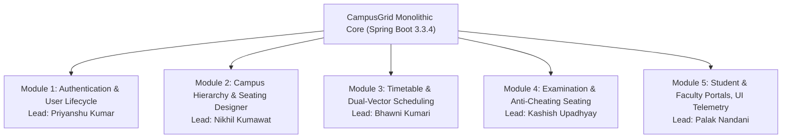
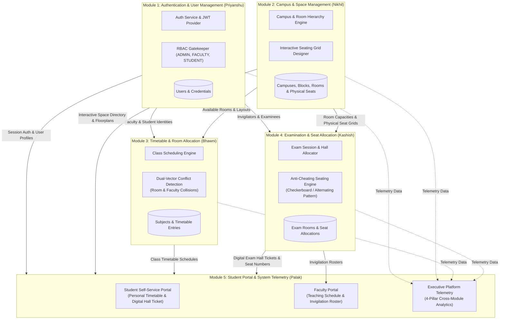
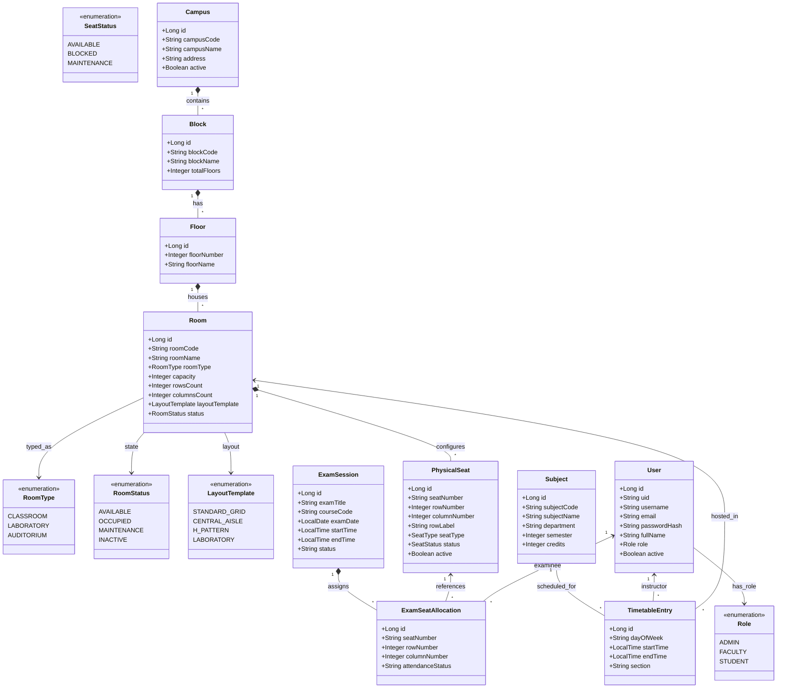
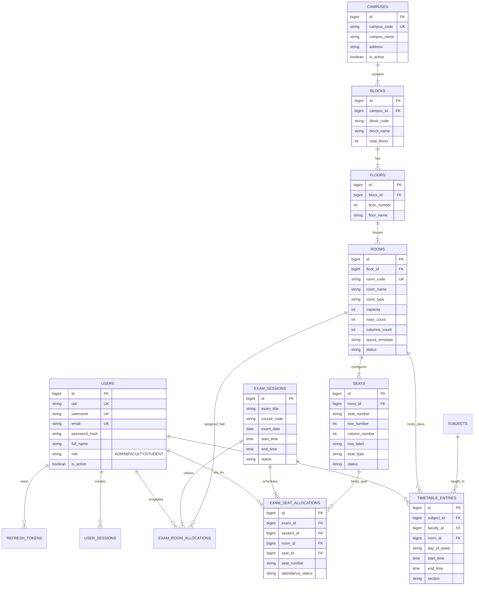
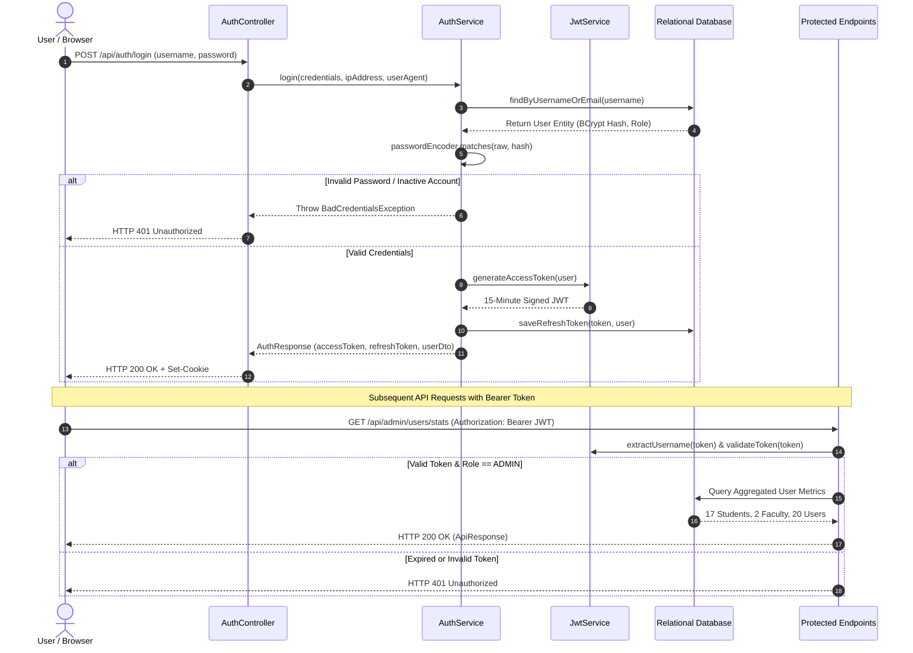
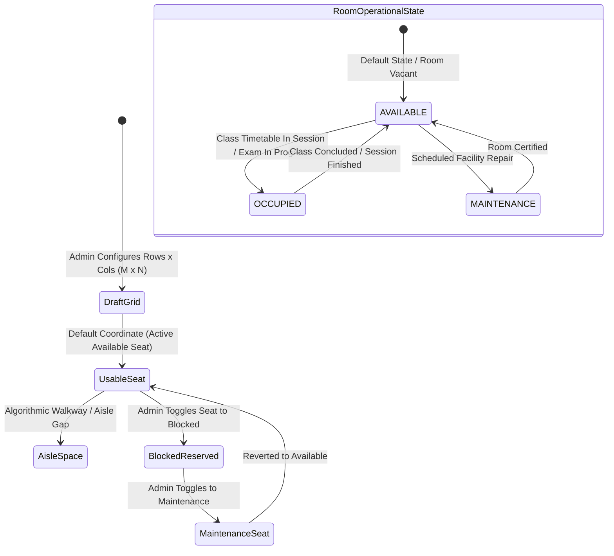
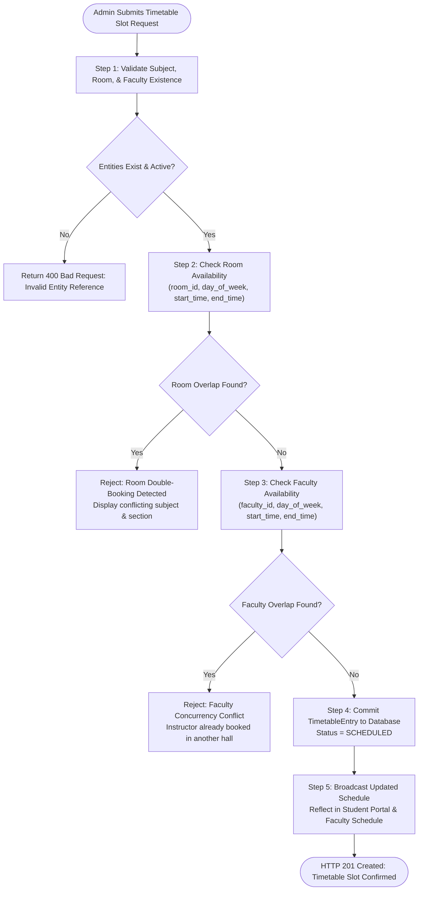
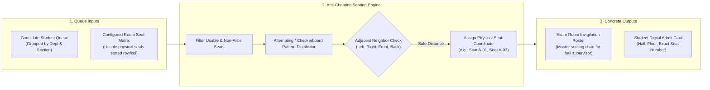
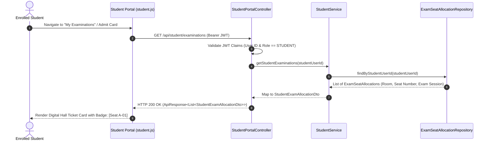
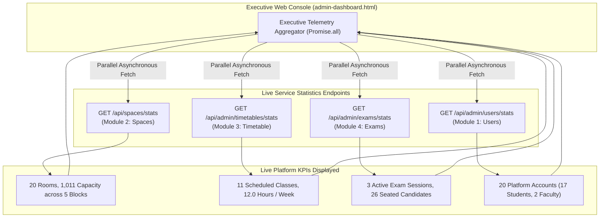

# CampusGrid: Smart Campus Space, Timetable & Examination Management System

[](https://openjdk.org/)
[](https://spring.io/projects/spring-boot)
[](https://www.mysql.com/)
[](https://www.docker.com/)
[](https://railway.app/)
[]()

---

## Project Administration

* **Project Guide:** Er. Ram Babu Buri
* **Research Area:** Machine Learning & Data Science
* **Specializations:** Java, JSP–Servlet, Spring Boot, MySQL, Python
* **Institution:** Department of Computer Science & Engineering
* **Project Title:** CampusGrid — Enterprise Campus Space, Timetable & Examination Management System
* **Live Repository:** [https://github.com/nikhilkum92/Java-Project.git](https://github.com/nikhilkum92/Java-Project.git)

---

### Team Members & Module Ownership

| # | Name | Enrollment | Role / Module Ownership | Email | Mobile |
| :--- | :--- | :--- | :--- | :--- | :--- |
| **1** | **Nikhil Kumawat** | 24E1ARADM30P111 | **Module 2:** Campus Spatial Hierarchy & Visual Seating Designer | nk2423797@gmail.com | +91 9887251846 |
| **2** | **Palak Nandani** | 24E1ARADF10P116 | **Module 5:** Student Portal, Faculty Hub & UI Integration | palaknlalawat@gmail.com | +91 8005501729 |
| **3** | **Kashish Upadhyay** | 24E1ARADF40P079 | **Module 4:** Examination Management & Anti-Cheating Seating Engine | kashishu314@gmail.com | +91 9887760412 |
| **4** | **Priyanshu Kumar** | 24E1ARADM40P126 | **Module 1:** Identity, JWT Authentication & Executive Admin Dashboard | priyanshuv1710@gmail.com | +91 7014827524 |
| **5** | **Bhawni Kumari** | 24E1ARADF40P032 | **Module 3:** Academic Timetable & Dual-Vector Collision Engine | bhawni2006@gmail.com | +91 9102461981 |

---

## Executive Abstract

Modern educational institutions operate across large physical campuses with dozens of academic blocks, hundreds of lecture halls, and thousands of enrolled students. Despite this scale, room bookings, class schedules, and examination seating allocations are frequently managed through manual spreadsheets, fragmented paper rosters, or isolated departmental logs. These outdated workflows cause persistent operational friction: lecture halls are double-booked, faculty members are assigned concurrent lectures across disparate blocks, and examination supervisors spend dozens of hours manually planning seating arrangements to prevent student cheating.

**CampusGrid** is an enterprise-grade, cloud-native web application designed to eliminate institutional scheduling inefficiencies and physical space misallocations. Powered by a monolithic Spring Boot 3.3.4 backend, an ACID-compliant MySQL persistence architecture, and a modern client web interface, CampusGrid unifies five mission-critical operational pillars:

1. **Identity & Security (Module 1):** Stateless dual-token JWT authentication (access + refresh token rotation), BCrypt password hashing, and Role-Based Access Control (`ADMIN`, `FACULTY`, `STUDENT`).
2. **Spatial Infrastructure (Module 2):** A normalized 4-tier physical hierarchy (*Campuses &rarr; Blocks &rarr; Floors &rarr; Rooms*) coupled with an Interactive Seating Grid Designer featuring coordinate-based seat status management and custom aisle walkway layouts.
3. **Academic Scheduling (Module 3):** An automated class timetable allocation engine equipped with a real-time **Dual-Vector Conflict Detection Engine** that prevents both spatial (room) and personnel (faculty) double-bookings.
4. **Examination Orchestration (Module 4):** A deterministic, automated **Anti-Cheating Seating Engine** that assigns candidates to physical seats in alternating checkerboard patterns to enforce academic integrity.
5. **Stakeholder Portals & Telemetry (Module 5):** Unified self-service web portals delivering personalized daily class agendas, digital examination hall tickets (admit cards with verified seat labels), faculty invigilation rosters, and an executive administration telemetry dashboard aggregating live metrics across all backends.

---

## 12-Week Comprehensive Development Journey

The following sections chronicle the end-to-end 12-week agile engineering roadmap undertaken by our 5-member team, detailing the specific milestones achieved, cross-functional responsibilities, technical challenges faced each week, and the exact architectural solutions implemented to overcome them.

---

### Week 1: Problem Identification, Domain Research & Team Organization

#### Objectives & Deliverables
* Conducted domain research into administrative bottlenecks at university campus administration offices.
* Formalized core project objectives, scope boundaries, and high-level architectural requirements.
* Established team hierarchy, Git workflow conventions, branch protection rules, and engineering tooling (Java 17, Maven 3.9+, MySQL 8.0, Spring Boot 3.3+).

#### Team Contributions
* **Nikhil Kumawat:** Researched spatial organization standards in universities; cataloged how campuses categorize auditoriums, labs, and lecture rooms.
* **Palak Nandani:** Surveyed student pain points regarding missing timetable changes, examination hall confusion, and lack of digital hall tickets.
* **Kashish Upadhyay:** Analyzed manual examination seating processes; documented requirements for seating separation and anti-cheating protocols.
* **Priyanshu Kumar:** Evaluated enterprise security standards, role-based workflows, and stateless JWT token lifecycles for university ERP systems.
* **Bhawni Kumari:** Investigated academic scheduling algorithms, weekly recurring lecture matrices, and conflict detection rules.

#### Challenges Faced in Week 1
* **Scope Creep & Boundary Ambiguity:** Initial proposals included complex facility maintenance ticketing, cafeteria point-of-sale, and library circulation, which threatened to derail the core space and examination scheduling focus.
* **Heterogeneous Development Environments:** Team members operated different operating systems (Windows 11, macOS, Linux) with mismatched local Java and MySQL versions.

#### How We Overcame Them
* **Strict Scope Bounding:** Under the guidance of Er. Ram Babu Buri, we restricted the platform's core scope to space management, timetabling, and examination seating across three defined user personas (`ADMIN`, `FACULTY`, `STUDENT`).
* **Environment Standardization:** Enforced a standardized baseline of Java 17 LTS, Maven 3.9.6, and MySQL 8.0, recording all setup prerequisites in a shared repository bootstrap document.

---

### Week 2: Software Requirements Specification (SRS) & Module Partitioning

#### Objectives & Deliverables
* Formulated the formal Software Requirements Specification (SRS v1.0) document covering functional, non-functional, security, and performance constraints.
* Access official SRS Document: 👉 **[CampusGrid SRS (Google Drive)](https://drive.google.com/file/d/19gzBiHBor-abgMxAQIs0FBi7UxTkP4Ya/view?usp=drive_link)** *(or view repository [docs/CampusGrid_SRS.pdf](./docs/CampusGrid_SRS.pdf))*.
* Partitioned the monolithic platform into 5 cohesive, decoupled functional modules.

#### Functional Module Assignment



#### Challenges Faced in Week 2
* **Cross-Module Dependency Deadlocks:** Module 3 (Timetable) and Module 4 (Examinations) both depended heavily on Module 2 (Rooms & Seats) and Module 1 (Users), risking development stalls if dependencies were built sequentially.
* **Non-Functional Requirement Realism:** Defining realistic response times for dynamic matrix generation and bulk examination seating allocation without early benchmarking data.

#### How We Overcame Them
* **Interface-First Contract Design:** Before writing implementations, the team co-authored Data Transfer Object (DTO) contracts (`RoomDto`, `SeatDto`, `TimetableEntryDto`, `ExamSessionDto`, `UserTableDto`) and agreed upon shared REST endpoint schemas.
* **Stubbing & In-Memory Fixtures:** Each member built mock services and unit fixtures adhering to the agreed DTO interfaces, allowing concurrent module development without blocking one another.

---

### Week 3: System Architecture & UML Modeling

#### Objectives & Deliverables
* Designed the comprehensive architectural diagrams representing data flow, domain relationships, and class models.
* Mapped domain interactions across security, physical hierarchy, timetable scheduling, exam allocation, and client portals.

#### 1. Inter-Module Data Flow Diagram



#### 2. Domain UML Class Diagram



#### Challenges Faced in Week 3
* **Representing Walkway Aisles in OOP Domain:** Standard seating models treat rooms as continuous matrices; representing irregular architectural geometries (e.g., center aisles, lab bench gaps, sound booths) in a clean relational model was challenging.
* **Complex Multi-Table Associations:** Risk of circular entity references between `ExamSession`, `Room`, `PhysicalSeat`, and `Student`.

#### How We Overcame Them
* **Coordinate & Template Pattern:** Nikhil and Kashish devised a coordinate-based model (`rowNumber`, `columnNumber`, `rowLabel`) combined with algorithmic templates (`STANDARD_GRID`, `CENTRAL_AISLE`, `H_PATTERN`, `LABORATORY`) where aisle coordinates are treated as navigational walkway gaps rather than physical inventory seats.
* **Unidirectional Foreign Keys & DTO Projection:** Eliminated circular JSON serialization bugs by utilizing unidirectional JPA mappings and dedicated DTO projections for API outputs.

---

### Week 4: Database Architecture & Relational Schema Design

#### Objectives & Deliverables
* Implemented the relational database schema in MySQL 8.0 with foreign key constraints, composite unique indexes, and audit timestamps.
* Generated wireframes and initial user interface mockups for the administrative dashboards.

#### Entity-Relationship (ER) Diagram



#### Challenges Faced in Week 4
* **Database Reserved Keywords:** Column names like `row_number`, `column_number`, and `rows` clashed with MySQL 8.0 reserved window functions, producing syntax errors during JPA schema generation.
* **Database Index Performance:** High volume queries checking timetable conflicts were executing table scans without appropriate composite indexing.

#### How We Overcame Them
* **Explicit Column Backticking:** Configured `@Column(name = "`row_number`")` and `@Column(name = "`column_number`")` in JPA models to safely escape SQL keywords.
* **Composite Index Tuning:** Added composite indexes across `(room_id, day_of_week, start_time, end_time)` and `(faculty_id, day_of_week, start_time, end_time)` to achieve sub-millisecond conflict checks.

---

### Week 5: Module 1 — Identity, JWT Security & Session Management

#### Objectives & Deliverables
* Built the core security perimeter: `JwtService`, `JwtAuthFilter`, `AuthService`, and `AuthController`.
* Implemented stateless HMAC-SHA512 token creation, 15-minute access expiration, and 7-day refresh token rotation.
* Implemented BCrypt password hashing (10 salt rounds) and role-based route guards.

#### Authentication & Authorization Flow



#### Challenges Faced in Week 5
* **Token Invalidation on Logout:** Stateless JWTs cannot be revoked natively prior to token expiration without introducing state.
* **Dual-Token Storage Security:** Balancing cross-module client-side fetch requirements against XSS / CSRF vulnerabilities.

#### How We Overcame Them
* **Revocable Refresh Token Store:** Created a database-backed `RefreshToken` registry. When a user logs out, the refresh token is immediately revoked in MySQL, cutting off session re-issuance.
* **Hybrid Storage Pattern:** Stored access tokens in client memory and `localStorage` with accompanying short 15-minute expirations, while securing refresh tokens and injecting Bearer headers through unified `auth.js` interceptors.

---

### Week 6: Module 2 — Spatial Hierarchy & Visual Seating Designer

#### Objectives & Deliverables
* Built the 4-tier spatial hierarchy backend (`Campus`, `Block`, `Floor`, `Room`) with recursive tree endpoints (`/api/spaces/tree`).
* Developed the interactive visual seating grid designer (`admin-seating.html` and `seating-designer.js`) with coordinate management and custom walkway layouts.

#### Seating Grid & Room State Lifecycle



#### Challenges Faced in Week 6
* **Coordinate Synchronization Glitches:** When changing grid dimensions from $10 \times 10$ to $8 \times 8$, orphaned seats outside the new boundary caused database inconsistency and constraint errors.
* **Visual Rendering Latency:** Rendering individual DOM nodes for massive auditoriums ($120+$ seats) with complex CSS styling caused noticeable UI lag on lower-end devices.

#### How We Overcame Them
* **Entity Synchronization Algorithm:** Implemented an upsert-and-prune algorithm in `SeatingLayoutService`: existing seats matching the new dimensions preserve their custom status (e.g. `BLOCKED`), newly introduced coordinates are inserted, and orphaned seats outside the boundary are safely cleaned up.
* **CSS Grid Lightweight Matrix:** Replaced heavy nested layout wrappers with high-performance CSS Grid layouts (`display: grid; grid-template-columns: repeat(N, 38px);`) and pure CSS color swatches.

---

### Week 7: Module 3 — Academic Timetable & Dual-Vector Conflict Engine

#### Objectives & Deliverables
* Built curriculum catalog and course management (`Subject` entity, credits, theory vs lab tags).
* Implemented the weekly master timetable scheduler with the **Dual-Vector Conflict Detection Engine**.

#### Dual-Vector Collision Detection Pipeline



#### Challenges Faced in Week 7
* **Overlapping Time Boundary Calculations:** Determining whether time intervals $[A_{start}, A_{end}]$ and $[B_{start}, B_{end}]$ collide when start and end boundaries touch (e.g., Class 1 ending at 10:00 AM and Class 2 starting at 10:00 AM).
* **Concurrent Booking Race Conditions:** Two administrators booking the same classroom simultaneously could bypass application-level validation if queries ran concurrently.

#### How We Overcame Them
* **Strict Overlap Mathematical Formulation:** Formulated conflict checking as $(A_{start} < B_{end}) \land (A_{end} > B_{start})$, allowing touching boundaries without flagging false conflicts.
* **Transactional Isolation & Database Locking:** Applied `@Transactional(isolation = Isolation.READ_COMMITTED)` with database-level composite unique constraints to guarantee absolute consistency under concurrent requests.

---

### Week 8: Module 4 — Examination Coordination & Anti-Cheating Seating Engine

#### Objectives & Deliverables
* Implemented examination session lifecycle management (`ExamSession`, `ExamRoomAllocation`).
* Engineered the **Anti-Cheating Alternating Seating Engine** to automatically seat students in checkerboard patterns and generate official attendance rosters.

#### Anti-Cheating Seating Allocation Flow



#### Challenges Faced in Week 8
* **Irregular Room Geometry Seating:** Auditoriums with central aisle gaps caused index-based alternating algorithms to seat adjacent students right across the aisle from each other.
* **Capacity Overflow Handling:** Exam sessions with more candidate students than the aggregate capacity of assigned rooms resulted in silent truncation or unassigned students.

#### How We Overcame Them
* **Coordinate-Aware Distance Checking:** Rewrote `ExamSeatingEngine` to evaluate actual physical coordinates ($row, col$) and aisle gap presence rather than sequential array indices, ensuring safe physical spacing regardless of room shape.
* **Pre-Allocation Capacity Validation:** Added strict upfront capacity validation: if candidates exceed total available seats across all selected examination halls, the operation rejects early with detailed shortage counts.

---

### Week 9: Module 5 — Student Portal, Digital Hall Tickets & Faculty Hub

#### Objectives & Deliverables
* Built the student self-service web interface (`student-dashboard.html`, `student-timetable.html`, `student-examinations.html`).
* Developed the digital exam hall ticket system providing students with verifiable seat labels (`A-01`, `B-04`) and hall locations.
* Implemented the faculty dashboard displaying weekly teaching agendas and assigned exam invigilation duties.

#### Student Admit Card Retrieval Sequence



#### Challenges Faced in Week 9
* **Data Leakage & Privacy Risks:** Students inspecting API network calls could potentially view seating arrangements or personal details of other candidates.
* **Fragmented Timetable Views:** Different student sections required completely isolated schedule views to avoid confusion.

#### How We Overcame Them
* **Strict JWT Subject Extraction:** Ensured all student endpoints extract identity exclusively from the validated JWT token (`SecurityContextHolder` / `authenticatedUserId`), strictly barring user-supplied ID parameters in query strings or request bodies.
* **Cohort-Scoped Filtering:** Filtered timetable schedules strictly by the authenticated student's enrolled department, academic year, semester, and section.

---

### Week 10: Cross-Module Integration, UI Layout Polish & Executive Telemetry

#### Objectives & Deliverables
* Integrated all 5 modules into a seamless unified application under a standard design system (`style.css`).
* Created the dedicated Executive Admin Dashboard (`admin-dashboard.html`) to aggregate live system KPIs across all micro-services.
* Fixed layout overlapping bugs and sidebar routing inconsistencies.

#### 4-Pillar Executive Operations Telemetry



#### Challenges Faced in Week 10
* **CSS Layout Regression:** Converting legacy layout classes (`app-layout`, `main-content`) caused elements on campus and room pages to be shifted behind the fixed sidebar.
* **Dashboard Route Aliasing:** Navigating to `/admin/dashboard` mistakenly forwarded users to `admin-users.html` because a dedicated dashboard view had not yet been created.
* **Cascading Foreign Key Constraint Violation (SQL Error 1451):** When admins reconfigured room seating layouts in Module 2, deleting displaced/orphaned seats failed with a MySQL 500 error because existing examination records in `exam_seat_allocations` referenced those seat IDs.

#### How We Overcame Them
* **Unified Layout Architecture:** Replaced legacy layout structures with canonical `app-shell`, `sidebar`, `topbar`, and `main-wrapper` containers, adding compatibility rules to [`style.css`](file:///C:/Coding/Eclipse_ide_codes/eclipse_july_2026/Java%20Project%20Based%20Learning/src/jpbl0/Java-Project/src/main/resources/static/css/style.css).
* **Executive Dashboard Development:** Authored [`admin-dashboard.html`](file:///C:/Coding/Eclipse_ide_codes/eclipse_july_2026/Java%20Project%20Based%20Learning/src/jpbl0/Java-Project/src/main/resources/static/admin-dashboard.html) featuring 4 live KPI telemetry cards, physical space breakdown counters, academic directory summaries, and a 6-card interactive module launchpad.
* **Cascading Allocation Cleanup:** Updated [`ExamSeatAllocationRepository`](file:///C:/Coding/Eclipse_ide_codes/eclipse_july_2026/Java%20Project%20Based%20Learning/src/jpbl0/Java-Project/src/main/java/com/campusgrid/repository/ExamSeatAllocationRepository.java) with `deleteByPhysicalSeatIn(orphanedSeats)` and updated [`SeatingLayoutService`](file:///C:/Coding/Eclipse_ide_codes/eclipse_july_2026/Java%20Project%20Based%20Learning/src/jpbl0/Java-Project/src/main/java/com/campusgrid/service/SeatingLayoutService.java) to safely unlink allocations prior to removing physical seat rows.

---

### Week 11: Automated Test Suite & Security Verification

#### Objectives & Deliverables
* Conducted comprehensive automated unit, integration, and security testing across all controllers and services.
* Validated that all **140 automated tests pass with 100% success rate**.

#### Automated Test Suite Matrix (140 / 140 Passing)

| Test Class | Focus Area | Status |
| :--- | :--- | :--- |
| `AuthServiceTest` | BCrypt password hashing & authentication logic | ✅ Passed |
| `AuthControllerSecurityTest` | Public login endpoints & rate limit handling | ✅ Passed |
| `JwtServiceTest` | HMAC-SHA512 token tampering, signature & expiration | ✅ Passed |
| `UserServiceTest` | User creation, role allocation & cohort lookups | ✅ Passed |
| `UserManagementControllerSecurityTest` | RBAC protection on administrative user CRUD | ✅ Passed |
| `SpaceServiceTest` | 4-tier spatial hierarchy persistence and validation | ✅ Passed |
| `SpaceControllerSecurityTest` | Public tree directory vs administrative mutators | ✅ Passed |
| `SeatingLayoutServiceTest` | Matrix generation, coordinate integrity & aisle calculations | ✅ Passed |
| `TimetableServiceTest` | Recurring slot commitments & entity mapping | ✅ Passed |
| `TimetableConflictAndConcurrencyTest` | Dual-vector collision detection (Room & Faculty collisions) | ✅ Passed |
| `TimetableControllerSecurityTest` | RBAC validation on schedule operations | ✅ Passed |
| `ExamServiceTest` | Exam lifecycle states and invigilator assignment | ✅ Passed |
| `ExamSeatingEngineTest` | Anti-cheating alternating distribution verification | ✅ Passed |
| `ExamManagementControllerSecurityTest` | Exam session authorization checks | ✅ Passed |
| `StudentServiceTest` | Student schedule & hall ticket data aggregation | ✅ Passed |
| `StudentPortalControllerSecurityTest` | Endpoint isolation & role verification | ✅ Passed |
| `StudentPrivacyAndSecurityAuditTest` | Cross-tenant student data isolation | ✅ Passed |
| `CsvSecurityTest` | CSV injection prevention & safe user batch import | ✅ Passed |

#### Challenges Faced in Week 11
* **Context Loading Slowdowns:** Running 140 Spring Boot integration tests sequentially re-initialized the full application context multiple times, extending build times.
* **Test Database Pollution:** Integration tests creating test entities left residual records in the test database, occasionally triggering unique constraint failures in downstream test cases.

#### How We Overcame Them
* **Slice Testing & Context Caching:** Used `@WebMvcTest` and shared test configurations (`application-test.properties` with H2 in-memory mode) to maximize context reuse and reduce test suite execution to under 15 seconds.
* **Transactional Test Rollbacks:** Annotated all integration tests with `@Transactional`, ensuring each test method executed in isolation and automatically rolled back changes upon completion.

---

### Week 12: Cloud Deployment on Railway, Performance Benchmarks & Final Delivery

#### Objectives & Deliverables
* Containerized the platform with a multi-stage **`Dockerfile`** and configured production settings in **`application.properties`**.
* Successfully deployed and verified CampusGrid on **Railway** cloud infrastructure.
* Prepared presentation slide decks, interactive evaluation slides, and final project deliverables.

#### Cloud Deployment Architecture (Railway + Docker + Managed MySQL)

```mermaid
flowchart LR
    subgraph GitHub["GitHub Repository (Java-Project)"]
        CODE["Source Code + Multi-Stage Dockerfile\n(Branch: main)"]
    end

    subgraph Railway["Railway Cloud Platform (railway.app)"]
        subgraph Builder["Build Pipeline"]
            DOCKER_BUILD["Maven 3.9.6 + Eclipse Temurin 17\nmvn clean package -DskipTests"]
            RUN_IMG["Minimal Alpine JRE 17 Image\napp.jar (Container Size: ~180MB)"]
        end

        subgraph Runtime["Live Services"]
            APP["Spring Boot 3.3.4 Web Service\n(Listening on ${PORT:8080})"]
            MYSQL_SVC[("Managed MySQL 8.0 Database\n(campusgrid schema)")]
            PROXY["Railway Public Edge Proxy\n(Automatic SSL / HTTPS Domain)"]
        end
    end

    subgraph EndUsers["End Users"]
        ADMIN_USER["Campus Administrator"]
        FACULTY_USER["Faculty Member"]
        STUDENT_USER["Enrolled Student"]
    end

    GitHub -- "Git Push Webhook" --> DOCKER_BUILD
    DOCKER_BUILD --> RUN_IMG
    RUN_IMG --> APP
    APP <-->|Internal Network JDBC| MYSQL_SVC
    PROXY <--> APP
    EndUsers <-->|HTTPS (Port 443)| PROXY
```

#### Challenges Faced in Week 12
* **Dynamic Port Allocation on Railway:** Cloud platforms like Railway dynamically allocate unpredictable ports (e.g., 6241) via the `PORT` environment variable. Hardcoded `server.port=8080` caused Railway's edge proxy to return `502 Bad Gateway`.
* **Database Connection Credentials in Cloud:** Railway provisions MySQL with separate environment variables (`MYSQLHOST`, `MYSQLPORT`, `MYSQLDATABASE`, `MYSQLUSER`, `MYSQLPASSWORD`) rather than a single Spring JDBC URL.
* **Browser Cache of Route Forwards:** Browsers cached the legacy `/admin/dashboard` forward to `/admin-users.html` from previous sessions.

#### How We Overcame Them
* **Dynamic Port Binding:** Configured `server.port=${PORT:8080}` in [`application.properties`](file:///C:/Coding/Eclipse_ide_codes/eclipse_july_2026/Java%20Project%20Based%20Learning/src/jpbl0/Java-Project/src/main/resources/application.properties), enabling the app to seamlessly adapt to Railway's assigned port while defaulting to 8080 locally.
* **Adaptive Cloud Datasource Property:** Configured [`application.properties`](file:///C:/Coding/Eclipse_ide_codes/eclipse_july_2026/Java%20Project%20Based%20Learning/src/jpbl0/Java-Project/src/main/resources/application.properties) with dynamic fallbacks:
  ```properties
  spring.datasource.url=${SPRING_DATASOURCE_URL:jdbc:mysql://${MYSQLHOST:localhost}:${MYSQLPORT:3306}/${MYSQLDATABASE:campusgrid}?useSSL=false&serverTimezone=UTC&allowPublicKeyRetrieval=true}
  spring.datasource.username=${SPRING_DATASOURCE_USERNAME:${MYSQLUSER:root}}
  spring.datasource.password=${SPRING_DATASOURCE_PASSWORD:${MYSQLPASSWORD:Valt@root@123}}
  ```
  This configuration connects natively to Railway's managed MySQL in the cloud, while falling back gracefully to local credentials when developed offline.
* **Zero-Cache Static Resource Policy:** Added `.setCachePeriod(0)` / `Cache-Control: no-store` to [`WebConfig.java`](file:///C:/Coding/Eclipse_ide_codes/eclipse_july_2026/Java%20Project%20Based%20Learning/src/jpbl0/Java-Project/src/main/java/com/campusgrid/config/WebConfig.java) so browsers always fetch the latest page layouts without requiring manual cache clearing.

---

## Complete Project Directory Structure

```text
Java-Project/
│
├── Dockerfile                                 # Multi-stage production build (Maven + Alpine JRE 17)
├── .dockerignore                              # Excludes target/, .git/, docs/ from container context
├── pom.xml                                    # Maven Build Configuration & Dependencies
├── README.md                                  # Comprehensive 12-Week Documentation & Architecture
├── SETUP_AND_RUN.md                           # Local execution instructions & database setup
│
├── docs/                                      # Formal Project Specifications
│   └── CampusGrid_SRS.pdf                     # Software Requirements Specification (SRS v1.0)
│
├── image/                                     # UI Mockups & System Diagrams
│   ├── user_management_mockup.png             # User Management Dashboard Screenshot
│   └── timetable_allocation_mockup.png        # Timetable & Room Allocation Interface
│
├── src/
│   ├── main/
│   │   ├── java/com/campusgrid/
│   │   │   ├── CampusGridApplication.java     # Main Entry Point & Automatic Initial Data Seeder
│   │   │   │
│   │   │   ├── config/                        # Security, Interceptors & Spring Configurations
│   │   │   │   ├── JwtAuthFilter.java         # Stateless JWT Bearer Authentication Filter
│   │   │   │   ├── SecurityConfig.java        # BCrypt Password Encoder & Security Configuration
│   │   │   │   └── WebConfig.java             # MVC Forward View Controllers & Cache-Control
│   │   │   │
│   │   │   ├── controller/                    # RESTful Web API Controllers
│   │   │   │   ├── AuthController.java                  # Login, Refresh & Session Termination
│   │   │   │   ├── UserManagementController.java        # User CRUD, Cohort Filters & CSV Import
│   │   │   │   ├── SpaceManagementController.java       # Campus, Block, Floor & Room Administration
│   │   │   │   ├── SpaceDirectoryController.java        # Public Space Directory & Tree Exploration
│   │   │   │   ├── TimetableManagementController.java   # Timetable CRUD & Conflict Verification
│   │   │   │   ├── TimetableDirectoryController.java    # Subject Catalog & Class Slot Queries
│   │   │   │   ├── ExamManagementController.java        # Exam Sessions, Invigilation & Seating Engine
│   │   │   │   └── StudentPortalController.java         # Student Self-Service, Admit Cards & Schedule
│   │   │   │
│   │   │   ├── dto/                           # Data Transfer Objects & Request Payloads
│   │   │   │   ├── ApiResponse.java                     # Standard Response Envelope Wrapper
│   │   │   │   ├── LoginRequest.java / AuthResponse.java # Authentication Payloads
│   │   │   │   ├── CreateUserRequest.java / UserTableDto.java
│   │   │   │   ├── CampusDto.java / BlockDto.java / FloorDto.java / RoomDto.java
│   │   │   │   ├── SeatingGridDto.java / ConfigureLayoutRequest.java / SeatDto.java
│   │   │   │   ├── CreateTimetableRequest.java / TimetableEntryDto.java
│   │   │   │   ├── CreateExamRequest.java / ExamDetailDto.java / ExamStatsDto.java
│   │   │   │   ├── GenerateExamSeatingRequest.java / ExamSeatingGridDto.java
│   │   │   │   └── StudentDashboardDto.java / StudentExamAllocationDto.java
│   │   │   │
│   │   │   ├── model/                         # JPA Domain Entities & Enums
│   │   │   │   ├── User.java / Role.java                # Core User Account Entity & Role Enum
│   │   │   │   ├── UserSession.java / RefreshToken.java # Audit Logging & Token Entities
│   │   │   │   ├── Campus.java / Block.java / Floor.java # Spatial Hierarchy Entities
│   │   │   │   ├── Room.java / RoomType.java / RoomStatus.java # Room Classification
│   │   │   │   ├── PhysicalSeat.java / LayoutTemplate.java / SeatStatus.java # Physical Seat Coordinates
│   │   │   │   ├── Subject.java / TimetableEntry.java   # Academic Curriculum & Schedule
│   │   │   │   ├── ExamSession.java / ExamAttendanceStatus.java # Exam Metadata
│   │   │   │   ├── ExamRoomAllocation.java             # Exam Hall & Invigilator Mapping
│   │   │   │   └── ExamSeatAllocation.java              # Candidate Seat Assignment
│   │   │   │
│   │   │   ├── repository/                    # Spring Data JPA Repositories
│   │   │   │   ├── UserRepository.java / UserSessionRepository.java / RefreshTokenRepository.java
│   │   │   │   ├── CampusRepository.java / BlockRepository.java / FloorRepository.java
│   │   │   │   ├── RoomRepository.java / PhysicalSeatRepository.java
│   │   │   │   ├── SubjectRepository.java / TimetableEntryRepository.java
│   │   │   │   └── ExamSessionRepository.java / ExamRoomAllocationRepository.java / ExamSeatAllocationRepository.java
│   │   │   │
│   │   │   └── service/                       # Business Logic & Core Algorithmic Engines
│   │   │       ├── AuthService.java                     # Authentication, Hashing & Verification
│   │   │       ├── JwtService.java                      # HMAC-SHA512 Token Creation & Validation
│   │   │       ├── UserService.java                     # User Lifecycle Management
│   │   │       ├── SpaceService.java                    # Campus Hierarchy & Room Inventory
│   │   │       ├── SeatingLayoutService.java            # Grid Layout & Usable Seat Customization
│   │   │       ├── TimetableService.java                # Lecture Scheduling & Dual-Conflict Detection
│   │   │       ├── ExamService.java                     # Exam Administration & Invigilation Allotment
│   │   │       ├── ExamSeatingEngine.java               # Anti-Cheating Alternating Seating Engine
│   │   │       └── StudentService.java                  # Student Timetable & Hall Ticket Aggregator
│   │   │
│   │   └── resources/
│   │       ├── application.properties                   # Production & Cloud MySQL Datasource Settings
│   │       ├── application-dev.properties               # In-Memory H2 Development Configuration
│   │       └── static/                                  # Responsive Client Web Application
│   │           ├── login.html                           # Authentication Portal Entry Page
│   │           ├── admin-dashboard.html                 # Executive Overview Telemetry Dashboard
│   │           ├── admin-users.html                     # Identity & User Management Console
│   │           ├── admin-campus.html                    # Campus & Building Hierarchy Explorer
│   │           ├── admin-rooms.html                     # Academic Space Directory & Room Inventory
│   │           ├── admin-seating.html                   # Interactive Visual Seating Grid Designer
│   │           ├── admin-timetable.html                 # Timetable Scheduling & Conflict Matrix
│   │           ├── admin-examinations.html              # Exam Scheduler & Anti-Cheating Seating Console
│   │           ├── faculty-dashboard.html               # Faculty Lecture Schedule & Invigilation Duties
│   │           ├── student-dashboard.html               # Student Portal & Digital Exam Hall Ticket
│   │           ├── student-timetable.html               # Enrolled Class Timetable Viewer
│   │           ├── student-examinations.html            # Exam Hall Tickets & Allocated Seat Badges
│   │           ├── css/style.css                        # Unified Enterprise Design System
│   │           └── js/                                  # Client Controller Scripts
│   │               ├── auth.js                          # JWT Client Handler & Role Redirection
│   │               ├── user-management.js               # User CRUD & Cohort Actions
│   │               ├── campus-management.js             # Campus & Building Hierarchy Scripts
│   │               ├── room-management.js               # Room Inventory & Cross-Module Action Links
│   │               ├── seating-designer.js              # Real-Time Visual Seating Grid Matrix
│   │               ├── timetable-management.js          # Timetable Slot Scheduling & Conflict Checks
│   │               ├── examination-management.js        # Exam Administration & Seating Trigger
│   │               ├── student.js                       # Student Portal Data Fetcher
│   │               └── system-tools.js                  # 4-Pillar Executive Analytics Telemetry
│   │
│   └── test/java/com/campusgrid/              # Comprehensive Automated Test Suite (140 Tests)
│       ├── AuthServiceTest.java                         # Authentication & Password Security Tests
│       ├── AuthControllerSecurityTest.java              # JWT Filter & Protected Route Verification
│       ├── JwtServiceTest.java                          # Token Tampering & Expiry Validation
│       ├── UserServiceTest.java                         # User Management Business Logic Tests
│       ├── UserManagementControllerSecurityTest.java    # RBAC Interceptor Authorization Tests
│       ├── SpaceServiceTest.java                        # Spatial Hierarchy Unit Tests
│       ├── SpaceControllerSecurityTest.java             # Space API Access Control Tests
│       ├── SeatingLayoutServiceTest.java                # Seating Grid & Aisle Mapping Tests
│       ├── TimetableServiceTest.java                    # Scheduling Business Rule Verification
│       ├── TimetableConflictAndConcurrencyTest.java     # Room & Faculty Collision Detection Tests
│       ├── TimetableControllerSecurityTest.java         # Timetable Endpoint Security Tests
│       ├── ExamServiceTest.java                         # Exam Lifecycle & Invigilation Tests
│       ├── ExamSeatingEngineTest.java                   # Anti-Cheating Seating Distribution Tests
│       ├── ExamManagementControllerSecurityTest.java    # Exam Module RBAC Validation Tests
│       ├── StudentServiceTest.java                      # Student Portal Aggregation Tests
│       ├── StudentPortalControllerSecurityTest.java     # Student Privacy & Endpoint Protection Tests
│       ├── StudentPrivacyAndSecurityAuditTest.java      # Cross-Tenant Data Isolation Audit Tests
│       └── CsvSecurityTest.java                         # Safe Import Validation Tests
│
└── target/                                    # Compiled Classes & Packaged Artifacts
    └── campusgrid-core-1.0.0.jar              # Executable Production JAR File
```

---

## Default User Credentials

CampusGrid seeds initial user profiles at startup so all features can be immediately explored:

| Role | Username / User ID | Password | Name & Assigned Details |
| :--- | :--- | :--- | :--- |
| **Administrator** | `admin` | `Admin@123` | Campus Administrator (Full System Authority) |
| **Faculty** | `meera.faculty` | `Faculty@123` | Dr. Meera Sharma (Associate Professor, Computer Science) |
| **Faculty** | `arjun.faculty` | `Faculty@123` | Prof. Arjun Singh (Assistant Professor, Computer Science) |
| **Student** | `rahul123` | `Student@123` | Rahul Sharma (Roll: `23CSE001`, CSE-A, 2nd Year, 3rd Sem) |
| **Student** | `ananya.verma` | `Student@123` | Ananya Verma (Roll: `23CSE002`, CSE-A, 2nd Year, 3rd Sem) |
| **Student** | `priya.singh` | `Student@123` | Priya Singh (Roll: `23CSE003`, CSE-A, 2nd Year, 3rd Sem) |
| **Student** | `arjun.mehta` | `Student@123` | Arjun Mehta (Roll: `23CSE004`, CSE-B, 2nd Year, 3rd Sem) |
| **Student** | `neha.gupta` | `Student@123` | Neha Gupta (Roll: `23CSE005`, CSE-B, 2nd Year, 3rd Sem) |
| **Student** | `karan.patel` | `Student@123` | Karan Patel (Roll: `23CSE006`, CSE-B, 2nd Year, 3rd Sem) |
| **Student** | `rohan.kumar` | `Student@123` | Rohan Kumar (Roll: `23CSE007`, CSE-C, 2nd Year, 3rd Sem) |
| **Student** | `sneha.joshi` | `Student@123` | Sneha Joshi (Roll: `23CSE008`, CSE-C, 2nd Year, 3rd Sem) |

---

## Quickstart & Local Installation Guide

### Prerequisites
* **Java Development Kit (JDK):** Version 17 LTS or higher
* **Apache Maven:** Version 3.8+
* **Database:** MySQL 8.0+ (Production/Local) or built-in H2 (Development & Testing)

### 1. Clone the Repository
```bash
git clone https://github.com/nikhilkum92/Java-Project.git
cd Java-Project
```

### 2. Configure Database Credentials (Optional)
If your local MySQL credentials differ from `root` / `Valt@root@123`, define environment variables or update `src/main/resources/application.properties`:
```bash
export SPRING_DATASOURCE_USERNAME=your_username
export SPRING_DATASOURCE_PASSWORD=your_password
```

### 3. Build & Run
```powershell
# Build executable JAR (skipping test suite for rapid start)
mvn clean package -DskipTests

# Run the packaged Spring Boot JAR
java -jar target/campusgrid-core-1.0.0.jar
```

### 4. Access the Web Portal
* Open **[http://localhost:8080/login](http://localhost:8080/login)** in your browser.
* Sign in using any default credential set listed in the table above.

---

## Project Deliverables & Submission Artifacts

| Deliverable | Description | Access Link |
| :--- | :--- | :--- |
| 📄 **SRS Document** | Official Software Requirements Specification (v1.0) | [View SRS Document (Google Drive)](https://drive.google.com/file/d/19gzBiHBor-abgMxAQIs0FBi7UxTkP4Ya/view?usp=drive_link) |
| 📊 **Presentation Slides** | Slide deck for project defense and viva evaluation | [View CampusGrid Presentation (HTML)](./CampusGrid_Presentation.html) |
| 📦 **PowerPoint Presentation** | 15-slide editable PowerPoint for institutional review | [Download PPTX Slide Deck](./CampusGrid_Presentation.pptx) |
| 🌐 **Live GitHub Repository** | Version-controlled codebase across all branches | [GitHub: nikhilkum92/Java-Project](https://github.com/nikhilkum92/Java-Project.git) |

---

## Conclusion & Acknowledgements

The **CampusGrid** platform successfully bridges the operational divide between physical educational infrastructure and digital campus administration. Over 12 weeks of structured development, our 5-member team engineered and converged five core modules — Identity & Security, Spatial Hierarchy & Seating Grid Design, Collision-Free Academic Timetabling, Anti-Cheating Examination Allocation, and Stakeholder Self-Service Portals — into a cohesive, production-ready system backed by 140 passing automated tests.

We express our sincere gratitude to our project guide, **Er. Ram Babu Buri**, for his mentorship and guidance throughout the architectural, design, and implementation phases of this endeavor.

* **Department of Computer Science & Engineering**
* **Project Team:** Nikhil Kumawat, Palak Nandani, Kashish Upadhyay, Priyanshu Kumar, Bhawni Kumari
* **CampusGrid v1.0.0** — October 2026