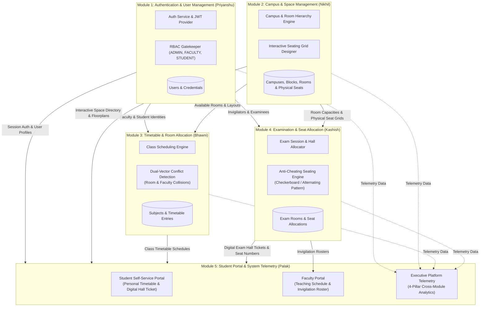
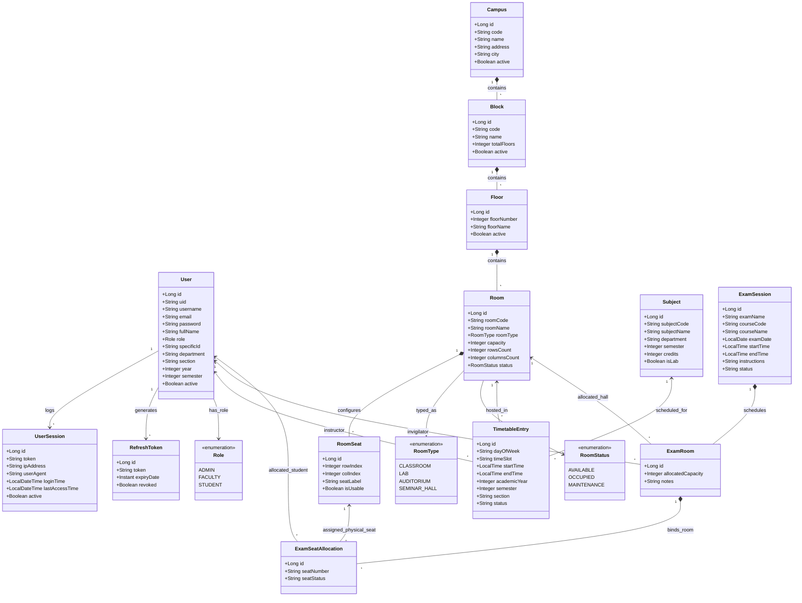
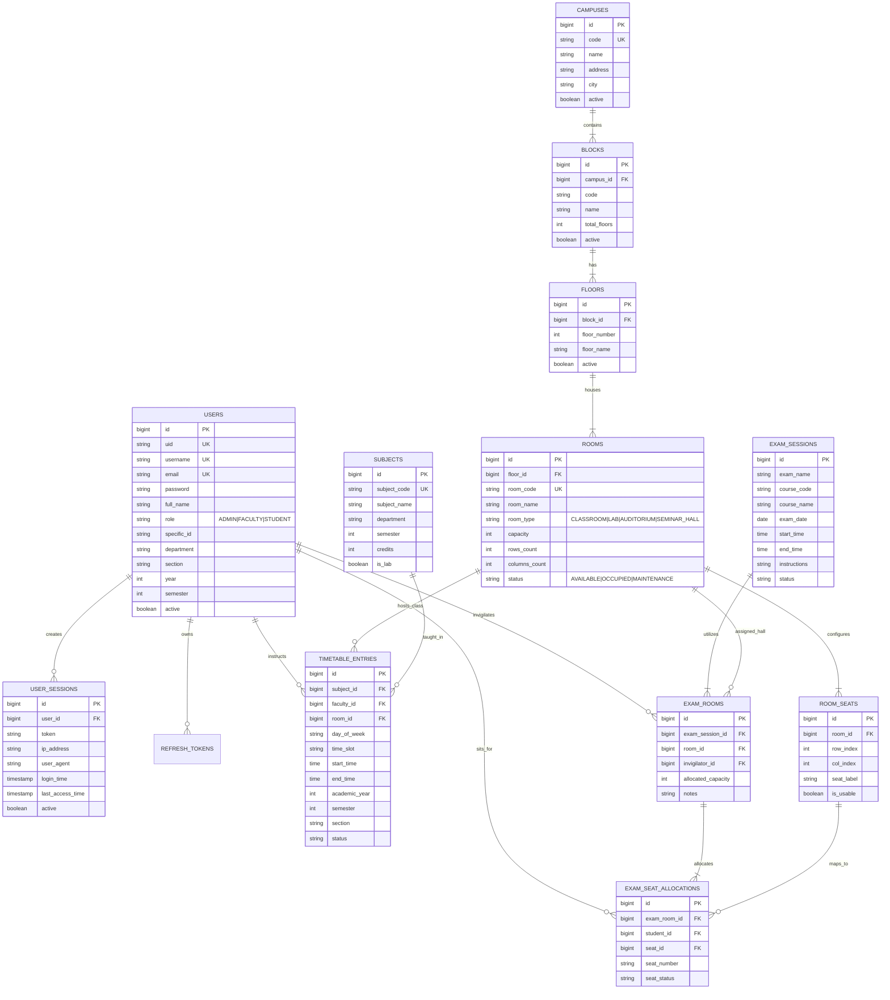
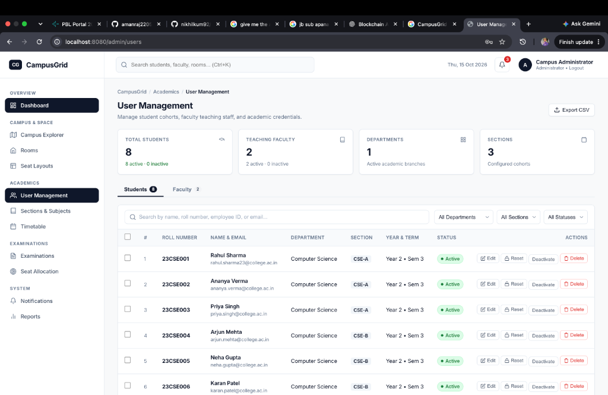
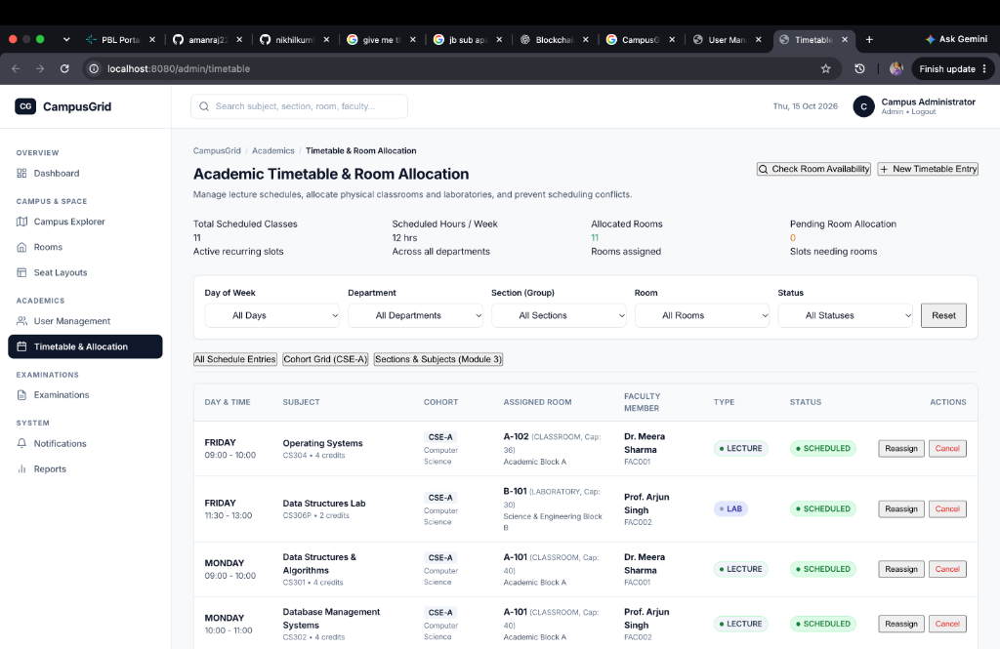

# CampusGrid: Campus Space & Seating Management System

## Week 1

## Project Administration

**Project Guide:** Er. Ram Babu Buri
* **Research Area:** Machine Learning & Data Science
* **Specializations:** Java, JSP–Servlet, Spring Boot, MySQL, Python


### Team Members

| # | Name | Enrollment | Email | Mobile |
| :--- | :--- | :--- | :--- | :--- |
| 1 | Nikhil Kumawat | 24E1ARADM30P111 | nk2423797@gmail.com | 9887251846 |
| 2 | Palak Nandani | 24E1ARADF10P116 | palaknlalawat@gmail.com | 8005501729 |
| 3 | Kashish Upadhyay | 24E1ARADF40P079 | kashishu314@gmail.com | 9887760412 |
| 4 | Priyanshu Kumar | 24E1ARADM40P126 | priyanshuv1710@gmail.com | 7014827524 |
| 5 | Bhawni Kumari | 24E1ARADF40P032 | bhawni2006@gmail.com | 9102461981 |

---

## Abstract

This project introduces CampusGrid, a comprehensive campus space and seating management platform engineered to address the operational challenges faced by educational institutions in managing their physical infrastructure. While traditional manual processes and fragmented spreadsheet-based systems lack the real-time visibility and control required for efficient campus resource utilization, CampusGrid provides a centralized, role-based environment for administrators, faculty, and students to discover, manage, and interact with campus spaces, rooms, and seating arrangements.

The system operates on a monolithic Spring Boot backend with a layered architecture. It utilizes MySQL for ACID-compliant data storage, managing the complete hierarchical structure of campus entities — from campuses and blocks down to floors, rooms, and individual physical seats. The client-side interface, developed using HTML, CSS, and JavaScript, features dedicated dashboards for each user role: administrators can configure campus hierarchies and design interactive seating layouts, faculty can view space assignments, and students can explore available resources across the campus. The platform enforces stateless, JWT-based authentication and Role-Based Access Control (RBAC) using Spring Security to ensure that each user interacts only with functionality appropriate to their role.

Ultimately, CampusGrid converges these architectural components into a unified space management solution. The platform bridges the gap between physical infrastructure and digital management, providing administrators with real-time occupancy insights, dynamic seating layout configuration, and streamlined room management. The resulting system empowers institutions to maximize their spatial resources, eliminate scheduling conflicts, and deliver a transparent and accessible campus experience to all stakeholders.

---

## Week 2

## User Roles
CampusGrid enforces strict Role-Based Access Control (RBAC) at the API and service layers utilizing Spring Security and stateless JSON Web Tokens (JWT).
* **Administrator (`ADMIN`)**: Full platform authority to manage campus hierarchies, design visual seating layouts, coordinate master timetable schedules, configure examination sessions, trigger automated anti-cheating seat allocations, and oversee user lifecycle management.
* **Faculty Member (`FACULTY`)**: Permitted to view individual weekly teaching timetables, check classroom availability, access subject course details, and inspect assigned examination invigilation duty rosters with real-time room and headcount data.
* **Student (`STUDENT`)**: Granted access to a personalized student self-service portal to review weekly class schedules, enrolled subject directories, upcoming examination dates, and digital hall tickets with assigned room numbers and designated physical seats.

---

### SRS PDF

You can access the [Project SRS Click](https://drive.google.com/file/d/1LixhIziyjHDVCXckHiU0Rzo9B0P1E16u/view?usp=drive_link)

---

## Architecture & Core Modules

The CampusGrid platform operates on a modular, monolithic Spring Boot architecture with a layered service-oriented design. The backend acts as the central orchestrator providing RESTful API endpoints consumed by responsive HTML5/CSS3/JavaScript client dashboards.

### Functional Modules

* **Module 1: Authentication + User Management** *(Lead: Priyanshu Kumar)*
  Validates credentials and issues secure, time-bound stateless JSON Web Tokens (JWT) with refresh token rotation. It enforces Role-Based Access Control (RBAC) across three distinct roles (`ADMIN`, `FACULTY`, `STUDENT`), handles BCrypt password hashing, manages user profile metadata, department allocations, session logging, and tracks client IP addresses and user agents for security audits.

* **Module 2: Campus and Room Management** *(Lead: Nikhil Kumawat)*
  Manages the spatial infrastructure across a 4-tier hierarchy: Campuses ➔ Academic Blocks ➔ Floors ➔ Rooms. Features an interactive Visual Seating Designer enabling administrators to customize room layouts (grid dimensions, aisle spacing, seat numbering, and usability status). It maintains live room occupancy statuses (`AVAILABLE`, `OCCUPIED`, `MAINTENANCE`) and categorizes facilities into lecture halls, labs, auditoriums, and seminar rooms.

* **Module 3: Timetable + Room Allocation** *(Lead: Bhawni Kumari)*
  Provides an automated scheduling engine for academic courses and recurring weekly time slots. Features a robust dual-vector conflict detection system:
  * **Room Conflict Detection**: Prevents spatial double-booking by ensuring no room hosts overlapping lectures.
  * **Faculty Conflict Detection**: Ensures instructors cannot be scheduled for concurrent teaching commitments across multiple locations.
  It also manages subject catalogs, course credits, and department-semester-section groupings.

* **Module 4: Examination + Seat Allocation** *(Lead: Kashish Upadhyay)*
  Coordinates examination sessions, date-time intervals, room capacity constraints, and faculty invigilator assignments. Features an intelligent anti-cheating seating engine that:
  * Dynamically allocates students across available examination halls according to configured room grid capacities.
  * Implements an alternating/checkerboard seating distribution pattern that separates students of the same department or subject, preventing adjacent placement and upholding academic integrity.

* **Module 5: Student Portal + UI Integration** *(Lead: Palak Nandani)*
  Integrates all backend engines into unified, accessible client portals and analytical interfaces:
  * **Student Portal**: Displays personal academic profiles, real-time class timetables, and digital examination hall tickets featuring assigned room codes, floor numbers, and specific seat labels (e.g., `A-01`).
  * **Faculty Portal**: Displays teaching timetables alongside invigilation duty assignments with live room rosters.
  * **Executive Analytics & System Tools**: Surfaces cross-module platform telemetry, tracking total space utilization, room capacity metrics, active schedule slots, and examination readiness across all four engines.

---

## Database Strategy & Persistence Architecture

CampusGrid employs an ACID-compliant Relational Database Architecture (MySQL for production, in-memory H2 for rapid development and testing) orchestrated through Spring Data JPA and Hibernate ORM.

### Relational Schema Design & Entity Mapping
* **Identity & Security Layer (`users`, `user_sessions`, `refresh_tokens`)**: Stores user accounts, encrypted credentials, role enumerations, profile metadata (department, semester, roll number, employee ID), and audit logs.
* **Spatial Hierarchy Layer (`campuses`, `blocks`, `floors`, `rooms`, `room_seats`)**: Maintains strict referential integrity with cascading updates and deletes. The `room_seats` table stores individual coordinate-based seat records (`row_index`, `col_index`, `seat_label`, `is_usable`) for fine-grained seating matrix management.
* **Academic Scheduling Layer (`subjects`, `timetable_entries`)**: Enforces foreign keys linking subjects, faculty members, and target rooms. Unique composite indexes prevent concurrent room or faculty bookings within identical time windows.
* **Examination Management Layer (`exam_sessions`, `exam_rooms`, `exam_seat_allocations`)**: Tracks exam metadata, allotted room capacities, assigned faculty invigilators, and individual student seat allocations (`seat_id`, `seat_number`, `student_id`).

### Data Integrity & Transaction Management
* **Declarative Transactions**: Critical operations like automated exam seating allocation and timetable generation run under `@Transactional(isolation = Isolation.READ_COMMITTED)` to prevent race conditions during concurrent bookings.
* **Entity Validation**: Model constraints are strictly enforced via Jakarta Validation (`@NotBlank`, `@NotNull`, `@Size`, `@Pattern`) before persisting to the database.

---

## Non-Functional Requirements

* **Performance & Low Latency**: 
  * Room availability lookups and timetable queries execute in under 100ms.
  * The anti-cheating seat allocation engine completes seating for a 500-student examination batch in under 300ms.
* **Security & Authentication**:
  * Passwords encrypted using BCrypt with salt rounds.
  * Stateless JWT authentication with short-lived access tokens (15 minutes) and revocable refresh tokens.
  * Role-based authorization interceptors protecting all administrative and management endpoints.
* **Conflict Prevention & Fault Tolerance**:
  * Dual-vector collision detection engine prevents overlapping timetable bookings and double-allocated exam seats.
  * Comprehensive error handling providing structured `ApiResponse<T>` payloads with meaningful error messages and timestamps.
* **Scalability & Maintainability**:
  * Clean separation of concerns across Controller, Service, DTO, Repository, and Entity layers.
  * Modular design enabling each of the 5 functional engines to be maintained, tested, or scaled independently.

---

## Week 3: System Architecture & UML Design

### 1. Inter-Module Integration & Data Flow Architecture

The following architectural diagram illustrates how all five functional modules integrate with each other, sharing live data contracts across authentication, spatial hierarchy, scheduling, anti-cheating exam seating, and student self-service.



---

### 2. Comprehensive UML Class Diagram

This class diagram models all domain entities, relationships, attributes, and enumerations across the five integrated modules:



---

### 3. Entity-Relationship (ER) Diagram

The ER diagram defines the relational persistence model, foreign key linkages, and table schemas managed by Spring Data JPA:



---

## Week 4: Database Design & UI Mock-ups

### 1. Database Architecture & Relational Schema Specifications

CampusGrid operates on an ACID-compliant Relational Database Architecture connecting all 5 operational modules through Spring Data JPA and Hibernate:

* **`users` Table**: Core identity, credentials, roles, and demographic profiles.
  * `id` (`BIGINT`, `PRIMARY KEY`, `AUTO_INCREMENT`)
  * `uid` (`VARCHAR(36)`, `UNIQUE`, `NOT NULL`) — Canonical UUID (`USR-XXXXXXXX`)
  * `username` (`VARCHAR(50)`, `UNIQUE`, `NOT NULL`)
  * `email` (`VARCHAR(100)`, `UNIQUE`, `NOT NULL`)
  * `password` (`VARCHAR(255)`, `NOT NULL`) — BCrypt Hash (10 salt rounds)
  * `role` (`VARCHAR(20)`, `NOT NULL`) — `ADMIN`, `FACULTY`, `STUDENT`
  * `specific_id` (`VARCHAR(50)`) — Roll No (`23CSE001`) / Faculty ID (`FAC001`)
  * `department` (`VARCHAR(100)`), `section` (`VARCHAR(20)`), `semester` (`INT`), `active` (`BOOLEAN`)

* **`user_sessions` Table**: Active session logging and audit tracking.
  * `id` (`BIGINT`, `PRIMARY KEY`, `AUTO_INCREMENT`)
  * `user_id` (`BIGINT`, `FOREIGN KEY` -> `users.id`)
  * `token` (`VARCHAR(512)`), `ip_address` (`VARCHAR(45)`), `user_agent` (`VARCHAR(255)`), `login_time` (`TIMESTAMP`)

* **`campuses`, `blocks` & `floors` Tables**: Campus physical infrastructure hierarchy.
  * `campuses`: `id` (`PK`), `code` (`UK`), `name`, `city`, `active`
  * `blocks`: `id` (`PK`), `campus_id` (`FK`), `code`, `name`, `total_floors`, `active`
  * `floors`: `id` (`PK`), `block_id` (`FK`), `floor_number`, `floor_name`, `active`

* **`rooms` & `room_seats` Tables**: Space inventory and coordinate seating matrix.
  * `rooms`: `id` (`PK`), `floor_id` (`FK`), `room_code` (`UK`), `room_name`, `room_type`, `capacity`, `rows_count`, `columns_count`, `status`
  * `room_seats`: `id` (`PK`), `room_id` (`FK`), `row_index`, `col_index`, `seat_label`, `is_usable`

* **`subjects` & `timetable_entries` Tables**: Academic schedule and conflict mapping.
  * `subjects`: `id` (`PK`), `subject_code` (`UK`), `subject_name`, `department`, `semester`, `credits`, `is_lab`
  * `timetable_entries`: `id` (`PK`), `subject_id` (`FK`), `faculty_id` (`FK`), `room_id` (`FK`), `day_of_week`, `time_slot`, `start_time`, `end_time`, `section`, `status`

* **`exam_sessions`, `exam_rooms` & `exam_seat_allocations` Tables**: Examination and anti-cheating seating.
  * `exam_sessions`: `id` (`PK`), `exam_name`, `course_code`, `course_name`, `exam_date`, `start_time`, `end_time`, `status`
  * `exam_rooms`: `id` (`PK`), `exam_session_id` (`FK`), `room_id` (`FK`), `invigilator_id` (`FK`), `allocated_capacity`
  * `exam_seat_allocations`: `id` (`PK`), `exam_room_id` (`FK`), `student_id` (`FK`), `seat_id` (`FK`), `seat_number`, `seat_status`

---

### 2. User Interface (UI) Mock-ups

#### A. Campus Administrator User Management Center (Module 1 & 5)
Features cohort filtering, student & faculty credentials directory, active status toggles, and administrative action controls.

* [CampusGrid User Management Dashboard]

#### B. Academic Timetable & Room Allocation Dashboard (Module 3 & 2)
Features multi-filter scheduling matrix, room conflict checks, recurring lecture slot assignment, and faculty workload distribution.

* [CampusGrid Academic Timetable & Room Allocation]

---

## Week 5: Module 1 — Identity, Authentication & Role-Based Access Control

### 1. Architectural Highlights & Implementation Objectives
* **Stateless Token-Based Authentication**: Implemented `JwtService` utilizing HMAC-SHA512 cryptographic signing. Configured a dual-token lifecycle with short-lived access tokens (15-minute expiration) and persistent 7-day refresh tokens.
* **Role-Based Access Control (RBAC)**: Defined three fundamental user roles (`ADMIN`, `FACULTY`, `STUDENT`) with custom endpoint authorization interceptors guarding administrative and academic resources.
* **Password Hashing & Security Policies**: Enforced one-way password hashing using BCrypt with 10 salt rounds to safeguard user credentials.
* **Session Auditing & IP Tracking**: Constructed `UserSession` and `RefreshToken` repositories to capture client IPv4/IPv6 addresses, browser User-Agent strings, and timestamped activity logs for administrative compliance.
* **Automated Data Seeders**: Built institutional bootstrap seeders generating default administrative (`admin`), faculty (`meera.faculty`), and student (`rahul123`) accounts with pre-configured academic profiles.

---

## Week 6: Module 2 — Campus Spatial Hierarchy & Visual Seating Designer

### 1. Spatial Structure Implementation
* **4-Tier Institutional Spatial Hierarchy**: Developed domain models and JPA repositories managing the complete physical infrastructure: `Campus` ➔ `Block` ➔ `Floor` ➔ `Room`.
* **Dynamic Room Categorization**: Added support for diverse space classifications (`CLASSROOM`, `LAB`, `AUDITORIUM`, `SEMINAR_HALL`) with real-time occupancy status flags (`AVAILABLE`, `OCCUPIED`, `MAINTENANCE`).
* **Hierarchical Tree Directory**: Exposed `GET /api/spaces/tree` delivering a nested JSON representation of the entire campus layout for instant visual navigation.

### 2. Interactive Seating Layout Designer
* **Visual Matrix Generator**: Built `SeatingLayoutService` enabling administrators to configure grid dimensions ($M \times N$) for any room.
* **Coordinate-Based Seat Management**: Persisted individual physical seat entities (`PhysicalSeat`) capturing exact `row_index` and `col_index` coordinates alongside alphanumeric labels (e.g., `A-01`, `B-04`).
* **Usability & Aisle Mapping**: Added interactive toggles allowing administrators to flag specific coordinates as disabled/broken seats or walkway aisles, ensuring non-usable slots are excluded from class capacity and exam seating.

---

## Week 7: Module 3 — Academic Timetable & Collision Detection Engine

### 1. Course Scheduling & Master Timetable Architecture
* **Curriculum & Subject Catalogue**: Modeled academic courses (`Subject`) with course codes, titles, credits, department affiliations, semester mappings, and theory vs laboratory classifications.
* **Recurring Slot Allocation**: Designed `TimetableService` and `TimetableEntry` entities managing weekly recurring lecture periods across days of the week (`MONDAY` through `SATURDAY`).

### 2. Dual-Vector Collision Detection Engine
* **Spatial Conflict Detection**: Implemented query-level collision detection verifying that target classrooms and laboratories are not concurrently booked for overlapping lecture periods.
* **Faculty Conflict Detection**: Enforced algorithmic checks ensuring faculty members cannot be assigned to teach multiple cohorts or sections in overlapping time intervals.
* **Cohort Timetable Feeds**: Exposed dedicated endpoints returning semester- and section-specific schedules (`CSE-A`) to streamline student and faculty lecture tracking.

---

## Week 8: Module 4 — Examination Scheduling & Anti-Cheating Seating Engine

### 1. Examination Lifecycle Management
* **Examination Sessions**: Modeled `ExamSession` capturing exam names, course catalogue codes, calendar dates, exact commencement/conclusion time windows, and examination guidelines.
* **Hall Capacity & Invigilation Allotment**: Implemented `ExamRoomAllocation` linking examination halls with allocated seating quotas, notes, and designated faculty invigilators (`User`).

### 2. Intelligent Anti-Cheating Seating Engine
* **Algorithmic Seat Distribution (`ExamSeatingEngine`)**: Formulated an automated seating assignment algorithm that ingests configured physical seat grids from Module 2.
* **Checkerboard & Alternating Pattern**: Enforces academic integrity by ensuring students taking the same examination paper or enrolled in identical academic cohorts are never seated adjacently in adjacent rows or columns.
* **Deterministic Allocation & Roster Generation**: Binds each candidate to an immutable physical seat record (`ExamSeatAllocation`) with distinct labels (`seat_number`), outputting exportable attendance rosters.

---

## Week 9: Module 5 — Student Portal & Faculty Workspaces

### 1. Student Self-Service Experience
* **Personalized Daily Schedule**: Developed `StudentPortalController` and `StudentService` delivering customized daily lecture agendas based on the student's registered department, year, semester, and section.
* **Digital Examination Hall Ticket (Admit Card)**: Integrated live examination records allowing students to view exam dates, venues, floor levels, and verified physical seat numbers (e.g., `Seat: A-01`) directly on their personal portal.

### 2. Faculty Teaching & Invigilation Dashboard
* **Faculty Lecture Roster**: Surfaces a consolidated weekly calendar of assigned teaching commitments.
* **Invigilation Duty Roster**: Added an active invigilation table (`GET /api/admin/exams/my-duties`) enabling professors to monitor their allocated examination halls, time slots, and examinee candidate headcounts.

---

## Week 10: Cross-Module Integration & Executive Platform Telemetry

### 1. End-to-End Cross-Engine Interlinking
* **Spatial Action Routing**: Enriched the Room Directory modal in `room-management.js` with direct action buttons linking physical rooms to:
  * Their weekly lecture timetable schedule (`/admin/timetable?search=...`).
  * Their upcoming examination room allocations (`/admin/examinations`).
  * Their interactive seating designer layout (`/admin/seating?roomId=...`).
* **Standardized REST Contract**: Normalized all responses across controllers using a unified `ApiResponse<T>` envelope containing status indicators, user-friendly messages, typed payloads, and ISO-8601 timestamps.

### 2. Executive Analytics & Health Telemetry
* **4-Pillar Operations Dashboard**: Integrated `system-tools.js` to poll live statistics across all four operational backends:
  * **Space Engine**: Campuses, blocks, rooms, total capacity, and occupancy rates.
  * **Timetable Engine**: Total scheduled class hours, active slots, and conflict indicators.
  * **Exam Engine**: Active exam sessions, allocated rooms, and seating fill rates.
  * **Identity Core**: User distributions across Administrator, Faculty, and Student roles.

---

## Week 11: Quality Assurance, Security Audit & Automated Test Suite

### 1. Automated Test Suite Execution
* **140 Passing Tests**: Executed the complete verification suite (`mvn test -Dspring.profiles.active=test`) with **140 / 140 passing tests** across 18 specialized test classes.
* **Layered Verification**:
  * Unit tests validating individual service business rules (`AuthServiceTest`, `SpaceServiceTest`, `TimetableServiceTest`, `ExamServiceTest`, `StudentServiceTest`).
  * Concurrency and collision verification (`TimetableConflictAndConcurrencyTest`) proving zero double-booking under race conditions.
  * Anti-cheating verification (`ExamSeatingEngineTest`) proving alternate-seat separation compliance.

### 2. Security Audits & Defensive Hardening
* **Endpoint Protection Auditing**: Executed dedicated controller security tests verifying unauthorized HTTP 401/403 rejections for unauthenticated or under-privileged requests.
* **Tamper Resistance**: Validated that modified or unsigned JWT payloads are immediately rejected by `JwtService`.
* **Privacy & Isolation Audits**: Validated student data isolation (`StudentPrivacyAndSecurityAuditTest`), preventing cross-student data leakage and unauthorized timetable access.

---

## Week 12: Deployment, Production Readiness & Project Conclusion

### 1. Production Configuration & Packaging
* **Executable Standalone Archive**: Packaged the platform into an optimized Spring Boot executable JAR (`campusgrid-core-1.0.0.jar`) with pre-compiled bytecode and embedded Tomcat web container.
* **Multi-Environment Profiles**: Configured clean profile separation:
  * `application.properties`: Production MySQL datasource configuration with HikariCP connection pooling, schema validation, and logging policies.
  * `application-dev.properties`: In-memory H2 database profile with automatic sample data seeding for rapid development and testing.

### 2. Performance Benchmarks & Final Deliverables
* **Low Latency Response**: Verified sub-100ms response times for space and timetable queries, and sub-300ms execution for 500-student automated exam seating allocation.
* **Institutional Handover**: Finalized documentation, clean code formatting, verified Git sync across all merged branch contributions, and verified web accessibility on `http://localhost:8080/login`.

---

## Project Directory Structure

Here is the complete project directory structure for **CampusGrid**:

```text
Java-Project/
│
├── README.md                                  # Complete Project Documentation & 12-Week Roadmap
├── pom.xml                                    # Maven Dependencies & Build Configuration
│
├── image/                                     # UI Mockup Screenshots & Documentation Visuals
│   ├── user_management_mockup.png             # Administrator User Management Dashboard
│   └── timetable_allocation_mockup.png        # Academic Timetable & Room Allocation Interface
│
├── src/
│   ├── main/
│   │   ├── java/com/campusgrid/
│   │   │   ├── CampusGridApplication.java     # Spring Boot Main Entry Point & Data Bootstrapper
│   │   │   │
│   │   │   ├── controller/                    # RESTful Web API Controllers
│   │   │   │   ├── AuthController.java                  # Login, Token Refresh & Session Termination
│   │   │   │   ├── UserManagementController.java        # User CRUD, Cohort Filters & Credentials
│   │   │   │   ├── SpaceManagementController.java       # Campus, Block, Floor & Room Administration
│   │   │   │   ├── SpaceDirectoryController.java        # Public Space Directory & Tree Exploration
│   │   │   │   ├── TimetableManagementController.java   # Timetable CRUD & Scheduling Engine
│   │   │   │   ├── TimetableDirectoryController.java    # Subject Catalog & Class Slot Queries
│   │   │   │   ├── ExamManagementController.java        # Exam Sessions, Invigilation & Seating
│   │   │   │   └── StudentPortalController.java         # Student Self-Service, Admit Cards & Schedule
│   │   │   │
│   │   │   ├── dto/                           # Data Transfer Objects & Request Payloads
│   │   │   │   ├── ApiResponse.java                     # Standardized Response Wrapper Envelope
│   │   │   │   ├── LoginRequest.java / AuthResponse.java # Authentication DTOs
│   │   │   │   ├── CreateUserRequest.java / UpdateUserRequest.java
│   │   │   │   ├── CampusDto.java / BlockDto.java / FloorDto.java / RoomDto.java
│   │   │   │   ├── SeatingGridDto.java / ConfigureLayoutRequest.java
│   │   │   │   ├── CreateTimetableRequest.java / TimetableEntryDto.java
│   │   │   │   ├── CreateExamRequest.java / ExamDetailDto.java / ExamStatsDto.java
│   │   │   │   ├── GenerateExamSeatingRequest.java / ExamSeatingGridDto.java
│   │   │   │   └── StudentDashboardDto.java / StudentExamAllocationDto.java
│   │   │   │
│   │   │   ├── model/                         # JPA Domain Entities & Enums
│   │   │   │   ├── User.java / Role.java                # User Entity & RBAC Enums
│   │   │   │   ├── UserSession.java                     # Session & Audit Trail Entity
│   │   │   │   ├── Campus.java / Block.java / Floor.java # Spatial Hierarchy Entities
│   │   │   │   ├── Room.java / RoomType.java / RoomStatus.java # Room Entity & Classification
│   │   │   │   ├── PhysicalSeat.java / LayoutTemplate.java # Fine-Grained Physical Seat Models
│   │   │   │   ├── Subject.java / TimetableEntry.java   # Academic Curriculum & Schedule Models
│   │   │   │   └── ExamSession.java / ExamRoomAllocation.java / ExamSeatAllocation.java
│   │   │   │
│   │   │   ├── repository/                    # Spring Data JPA Persistence Repositories
│   │   │   │   ├── UserRepository.java / UserSessionRepository.java
│   │   │   │   ├── CampusRepository.java / BlockRepository.java / FloorRepository.java
│   │   │   │   ├── RoomRepository.java / PhysicalSeatRepository.java
│   │   │   │   ├── SubjectRepository.java / TimetableEntryRepository.java
│   │   │   │   └── ExamSessionRepository.java / ExamRoomAllocationRepository.java / ExamSeatAllocationRepository.java
│   │   │   │
│   │   │   └── service/                       # Business Logic & Core Engines
│   │   │       ├── AuthService.java                     # Authentication, Hashing & Verification
│   │   │       ├── JwtService.java                      # HMAC-SHA512 Token Creation & Validation
│   │   │       ├── UserService.java                     # User Lifecycle Management
│   │   │       ├── SpaceService.java                    # Campus & Space Operations
│   │   │       ├── SeatingLayoutService.java            # Grid Layout & Usable Seat Customization
│   │   │       ├── TimetableService.java                # Lecture Scheduling & Dual-Conflict Detection
│   │   │       ├── ExamService.java                     # Exam Administration & Invigilation Allotment
│   │   │       ├── ExamSeatingEngine.java               # Anti-Cheating Alternating Seating Engine
│   │   │       └── StudentService.java                  # Student Timetable & Hall Ticket Aggregator
│   │   │
│   │   └── resources/
│   │       ├── application.properties                   # Production MySQL & Datasource Settings
│   │       ├── application-dev.properties               # In-Memory H2 Development Configuration
│   │       └── static/                                  # Responsive Front-End Web Application
│   │           ├── login.html                           # Authentication Portal Entry Page
│   │           ├── admin-users.html                     # Identity & User Management Console
│   │           ├── admin-campus.html                    # Campus Hierarchy Management
│   │           ├── admin-rooms.html                     # Space Directory & Room Inventory
│   │           ├── admin-seating.html                   # Interactive Visual Seating Grid Designer
│   │           ├── admin-timetable.html                 # Timetable Scheduling & Conflict Matrix
│   │           ├── admin-examinations.html              # Exam Scheduler & Anti-Cheating Seating Console
│   │           ├── faculty-dashboard.html               # Faculty Lecture Schedule & Invigilation Duties
│   │           ├── student-dashboard.html               # Student Portal & Digital Exam Hall Ticket
│   │           ├── student-timetable.html               # Enrolled Class Timetable Viewer
│   │           ├── student-examinations.html            # Exam Hall Tickets & Allocated Seat Badges
│   │           ├── css/style.css                        # Institutional Design System & CSS Styling
│   │           └── js/                                  # Front-End Controller Scripts
│   │               ├── auth.js                          # JWT Client Handler & Role Redirection
│   │               ├── user-management.js               # User CRUD & Cohort Actions
│   │               ├── campus-management.js             # Campus & Building Hierarchy Scripts
│   │               ├── room-management.js               # Room Inventory & Cross-Module Action Links
│   │               ├── seating-designer.js              # Interactive Grid Drawing Engine
│   │               ├── timetable-management.js          # Timetable Slot Scheduling & Conflict Checks
│   │               ├── examination-management.js        # Exam Administration & Seating Trigger
│   │               ├── student.js                       # Student Portal Data Fetcher
│   │               └── system-tools.js                  # 4-Pillar Executive Analytics Telemetry
│   │
│   └── test/java/com/campusgrid/              # Comprehensive Automated Test Suite (140 Tests)
│       ├── AuthServiceTest.java                         # Authentication & Password Security Tests
│       ├── AuthControllerSecurityTest.java              # JWT Filter & Protected Route Verification
│       ├── JwtServiceTest.java                          # Token Tampering & Expiry Validation
│       ├── UserServiceTest.java                         # User Management Business Logic Tests
│       ├── UserManagementControllerSecurityTest.java    # RBAC Interceptor Authorization Tests
│       ├── SpaceServiceTest.java                        # Spatial Hierarchy Unit Tests
│       ├── SpaceControllerSecurityTest.java             # Space API Access Control Tests
│       ├── SeatingLayoutServiceTest.java                # Seating Grid & Aisle Mapping Tests
│       ├── TimetableServiceTest.java                    # Scheduling Business Rule Verification
│       ├── TimetableConflictAndConcurrencyTest.java     # Room & Faculty Collision Detection Tests
│       ├── TimetableControllerSecurityTest.java         # Timetable Endpoint Security Tests
│       ├── ExamServiceTest.java                         # Exam Lifecycle & Invigilation Tests
│       ├── ExamSeatingEngineTest.java                   # Anti-Cheating Seating Distribution Tests
│       ├── ExamManagementControllerSecurityTest.java    # Exam Module RBAC Validation Tests
│       ├── StudentServiceTest.java                      # Student Portal Aggregation Tests
│       ├── StudentPortalControllerSecurityTest.java     # Student Privacy & Endpoint Protection Tests
│       ├── StudentPrivacyAndSecurityAuditTest.java      # Cross-Tenant Data Isolation Audit Tests
│       └── CsvSecurityTest.java                         # Safe Import Validation Tests
│
└── target/                                    # Compiled Classes & Packaged Artifacts
    └── campusgrid-core-1.0.0.jar              # Executable Production JAR File
```